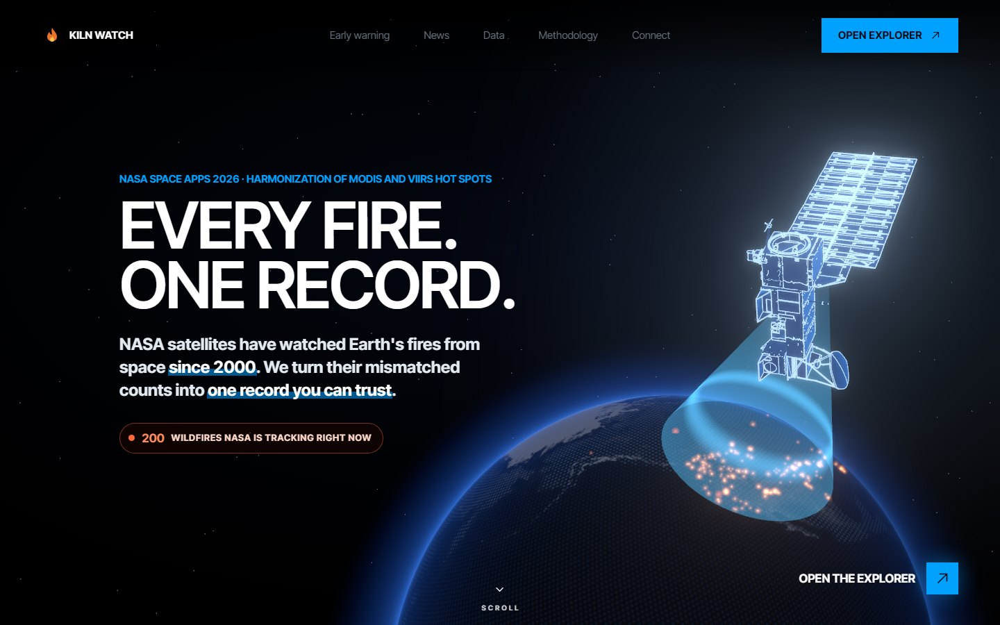
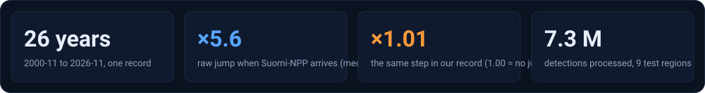
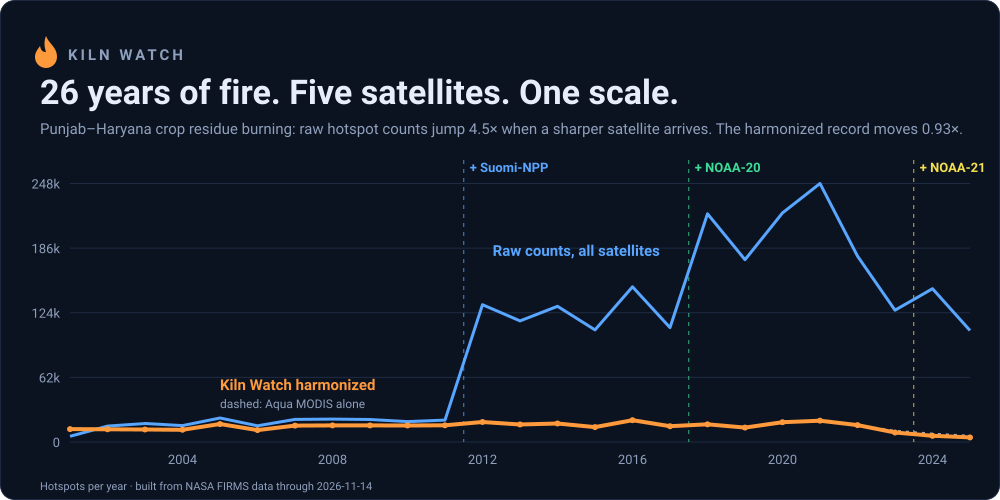
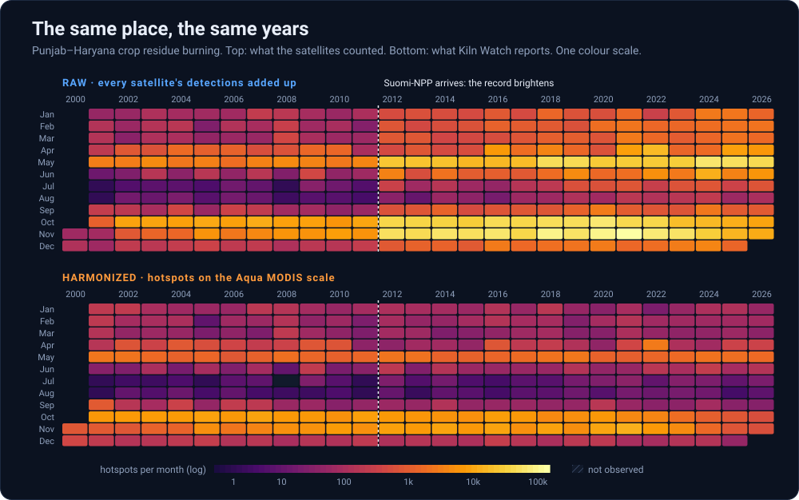
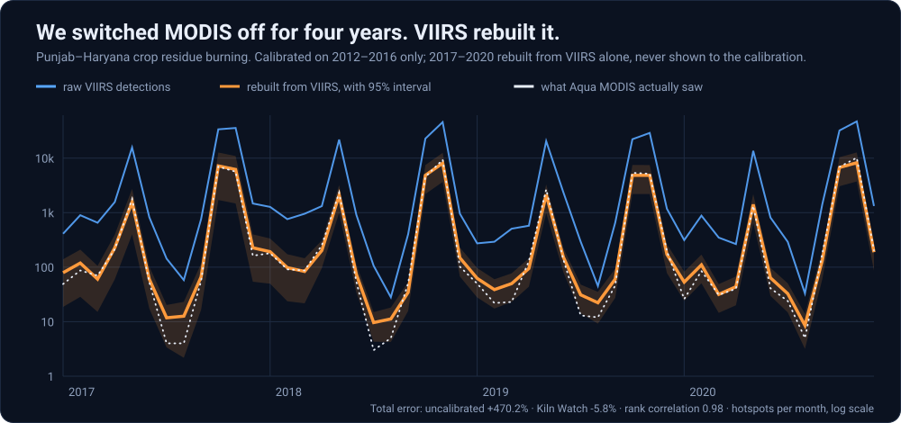
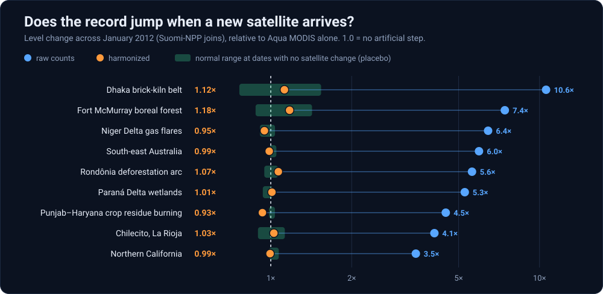
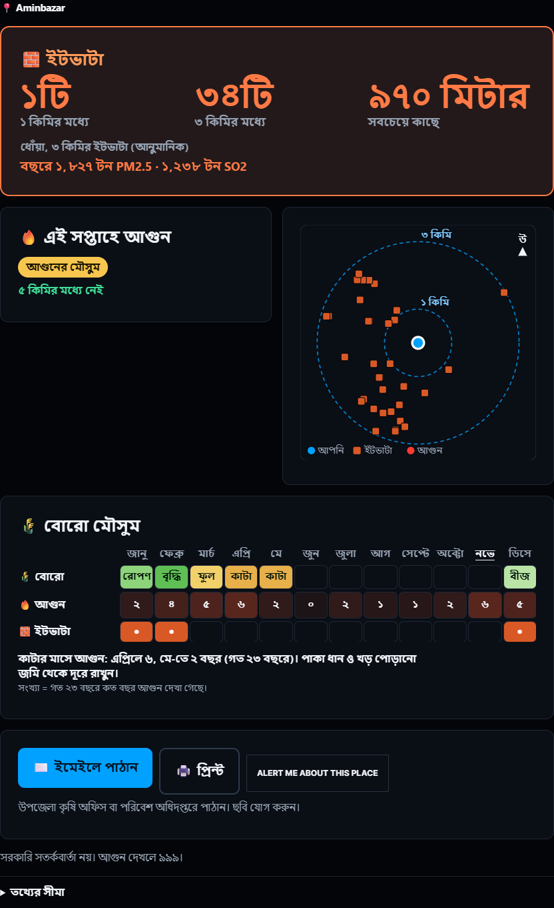

<h1 align="center">Kiln Watch</h1>

  

  <b>One fire record for any place on Earth, from 2000 to today, that does not jump when satellites change.</b> 
  NASA Space Apps Challenge 2026 · <i>Harmonization of MODIS and VIIRS Hot Spots</i> · Team Off The Binary, Bangladesh

<h3 align="center">Live: <a href="https://kiln-watch-seven.vercel.app">kiln-watch-seven.vercel.app</a> · <a href="https://www.youtube.com/watch?v=pXaGiUv_ifM">Demo video</a></h3>

## For judges: 60 seconds

- **The jump.** In 2012 a sharper satellite (VIIRS) joined the older one (MODIS). Raw fire counts jumped **×5.6** (median of
  nine areas) with no change on the ground.
- **The fix.** We measure how much more each satellite sees, month by month, and put all five on one scale (Aqua MODIS).
  The same step in our record: **×1.01**, where 1.00 means no jump.
- **The proof.** We hid MODIS after 2016 and rebuilt 2017–2020 from VIIRS alone. In 7 of 9 areas the rebuilt record is
  within 10% of what MODIS really saw; uncalibrated counts are off by 470% to 1,767%. So the record survives the end of MODIS.
- **The farmer check.** In Bangladesh, a farmer types a village (in Bangla) and gets the brick kilns next to the field,
  fire this week, and this month against 26 years on one scale, ready to email, WhatsApp or print for the agriculture office.

## Try it

| Click | You will see |
|---|---|
| [Punjab, 26 years](https://kiln-watch-seven.vercel.app/#pg=explore&r=punjab) | The burning calendar: one square per month, one row per year, no jump in 2012 |
| [The scorecard](https://kiln-watch-seven.vercel.app/#pg=method) | Nine areas, every test, a plain trust label, and where it falls short |
| [After MODIS](https://kiln-watch-seven.vercel.app/#pg=after) | Switch satellites off and watch the record hold |
| [Is fire near Ludhiana?](https://kiln-watch-seven.vercel.app/#pg=cases&q=Ludhiana%2C%20India) | Fire seen this week, when fire usually comes, and the schools and hospitals near it |
| [Farmer check, Aminbazar](https://kiln-watch-seven.vercel.app/#pg=bangladesh&q=Aminbazar%2C%20Savar%2C%20Bangladesh) | Kilns within 1 and 3 km, their estimated smoke, the Boro season, in Bangla with a Listen button |
| `claude mcp add --transport http kiln-watch https://kiln-watch-seven.vercel.app/mcp` | 35 read-only fire tools for Claude over the same record |

## The problem

## The fix

Aqua MODIS is the reference: its afternoon orbit is the only one flown from 2002 through every VIIRS satellite. Each
satellite is linked to it by a ratio of monthly totals per calendar month, day and night apart, shrunk by empirical Bayes;
NOAA-20 and NOAA-21 are chained through Suomi-NPP. Which satellite flew when, Aqua's drift (2023) and Suomi-NPP's last day
(2 November 2026) are read from the data, never typed in. Every value carries a 95% interval.
[Why this method, and what we tried instead](docs/DETAILS.md#why-this-method).

## The proof

| Claim | Result | What this does not show |
|---|---|---|
| The 2012 jump is the satellite, not the fire | Raw ×5.6, ours ×1.01 (median of 9 areas) | That fire did not change: only that the satellite change leaves no step |
| The record survives the end of MODIS | 7 of 9 areas within 10% with MODIS hidden for 2017–2020 (trust label High); Dhaka +13% (Medium), Paraná Delta +27% (Low) | Places outside the built areas: a new area has no score until its record is built |
| The ranges are honest | 79% to 100% of held-out months fall inside the 95% interval | Northern California (79%) is too narrow for years unlike its training years |
| An outside check agrees | NASA MCD64A1 burned area: in 2012 raw counts jump ×4.89, ours moves ×1.03, burned area ×0.72 | Burned area is guided by MODIS hotspots, so it is not fully independent |
| FIRMS cannot count kilns | Near Dhaka, 4.6% of mapped kilns had a VIIRS hotspot within 500 m; random ground 4.2% | So the farmer check reads a kiln inventory, never the fire detections |

<b>Full results table, nine areas</b>

 

| Region | Raw step ÷ Aqua | Harmonized step ÷ Aqua | Error, uncalibrated | Error, Kiln Watch | Rank ρ | Interval coverage, unwidened | Interval coverage, out of sample | Trend/yr raw | harmonized | Aqua only |
|---|---|---|---|---|---|---|---|---|---|---|
| Dhaka brick-kiln belt | 10.58 | 1.12 | +1767.3% | +13.1% | 0.68 | 42% | 88% | 1.5 | 0.0 | 0.0 |
| Punjab–Haryana crop residue burning | 4.48 | 0.93 | +470.2% | -5.8% | 0.98 | 94% | 92% | 70.0 | 0.1 | -0.2 |
| Chilecito, La Rioja | 4.06 | 1.03 | +812.2% | -9.7% | 0.89 | 35% | 96% | 3.3 | -0.0 | -0.0 |
| Rondônia deforestation arc | 5.61 | 1.07 | +515.8% | -0.6% | 0.98 | 77% | 96% | 51.7 | -0.1 | -0.3 |
| Fort McMurray boreal forest | 7.43 | 1.18 | +1032.3% | -8.9% | 0.83 | 58% | 96% | 1.3 | 0.0 | 0.0 |
| South-east Australia | 5.95 | 0.99 | +813.7% | +4.1% | 0.98 | 65% | 92% | 38.7 | -0.9 | -1.0 |
| Northern California | 3.47 | 0.99 | +785.4% | +8.1% | 0.98 | 67% | 79% | 29.3 | 1.2 | 1.2 |
| Paraná Delta wetlands | 5.27 | 1.01 | +596.1% | +27.5% | 0.94 | 79% | 92% | 7.3 | -1.5 | -1.7 |
| Niger Delta gas flares | 6.44 | 0.95 | +569.9% | -1.7% | 0.98 | 77% | 100% | 73.0 | 0.3 | 0.1 |

Errors are from the MODIS-denial test (calibrate on 2012–2016, rebuild 2017–2020 from VIIRS alone). Intervals are widened
so 95% of the 2017–2020 test months fall inside. To check that this is not circular, the widening is also fitted on
2017–2018 alone and tested on 2019–2020: that is the out-of-sample column. Trends are seasonal Sen slopes for
2003–2020: the median of the per-season Sen slopes, which is what a seasonal test should report, not the pooled slope
over all months.
How to read every column: the [Proof page](https://kiln-watch-seven.vercel.app/#pg=method).

## Bangladesh: what is near your field?

Farmers near brick kilns say the smoke damages their rice, but when they complain they are asked to show a kiln is there
at all. The [farmer check](https://kiln-watch-seven.vercel.app/#pg=bangladesh&q=Aminbazar%2C%20Savar%2C%20Bangladesh)
shows it, Bangla first: the kilns within 1 and 3 km from a national inventory (APAD, 4,760 kilns, CC BY 4.0), fire this
week, this month against 26 years, and the Boro season, ready to email, WhatsApp or print for the Upazila Agriculture Office.
It shows that kilns stand near a field; it does not prove crop damage. [The measurements behind it](docs/DETAILS.md#who-it-is-for).

## Limits that matter most

- **No cloud correction yet.** A month under cloud reads low in every year alike, so it is consistent, but low.
- **Satellites pass at fixed times.** A fire lit and finished between passes is never seen. In Punjab a NASA scientist
  reported, from a geostationary satellite, that burning has moved after the early-afternoon pass since 2024 (not yet
  checked on the ground); if so, recent low counts there are partly timing.
- **After MODIS the chain does not fully close.** NOAA-20 straight to Aqua and NOAA-20 through Suomi-NPP disagree by up to
  about 90% at night in some areas; the gap is added to the interval, not hidden.
- **Detections are not fires and not burned area**, and the early warning is history plus the present, never a forecast.

Every alternative we tested and every check that failed, with numbers: [HARMONIZATION_TESTS.md](HARMONIZATION_TESTS.md).
Everything else (all shortfalls, exposure, NASA's open questions, how it is built, hosting, how to run it, references):
[docs/DETAILS.md](docs/DETAILS.md).

## Data used

Every fire number comes from NASA data, read in place with DuckDB from the public GeoParquet mirror of NASA FIRMS.

| NASA dataset | How we used it |
|---|---|
| [FIRMS](https://earthdata.nasa.gov/firms) MODIS C6.1 (Terra, Aqua) | Every MODIS detection 2000–today; Aqua is the reference scale |
| [FIRMS](https://earthdata.nasa.gov/firms) VIIRS 375 m C2 (Suomi-NPP, NOAA-20, NOAA-21) | Calibrated to Aqua; end dates read from the data |
| [GIBS](https://gibs.earthdata.nasa.gov) thermal anomalies and true colour | Daily fire layer and base map for the chosen day |
| [Black Marble](https://blackmarble.gsfc.nasa.gov) and [Blue Marble](https://visibleearth.nasa.gov/collection/1484/blue-marble) | Night-lights base map, kiln-season night lights, the 3D Earth |
| [EONET](https://eonet.gsfc.nasa.gov) | Wildfire events beside the record and as a witness |
| [MCD64A1](https://lpdaac.usgs.gov/products/mcd64a1v061/) burned area | An independent check of the record, and a witness per fire case |
| [NASA 3D Resources](https://science.nasa.gov/3d-resources/) | The satellite models on the home page |

<b>Other space agency data and other datasets</b>

 

ESA Copernicus Sentinel-1 and Sentinel-2 (through a published kiln map), ESA WorldCover cropland, WorldPop 2020,
OpenStreetMap (Overpass, Nominatim, OpenFreeMap), the APAD Bangladesh kiln inventory, the Bangladesh brick-kiln map
(deluair, CC BY-NC), BAMIS Boro calendars, GDACS, GDELT, Google News, Natural Earth. Full table with links and licences:
[docs/DETAILS.md](docs/DETAILS.md).

We acknowledge the use of data and imagery from NASA's Fire Information for Resource Management System (FIRMS)
(https://earthdata.nasa.gov/firms), part of NASA's Earth Observing System Data and Information System (EOSDIS).
Kiln Watch is an independent project, not an official NASA product.

## Use of AI

| Tool | Used for | Data it worked on |
|---|---|---|
| Claude Fable 5.2 (Anthropic) | Planning: brief, literature and rules review, method design; a pre-submission review of the site | Public challenge page, papers, NASA/NOAA docs; our site and code |
| Gemini Argon (Google) | Planning: research briefs and the first technical specification | Public challenge page, papers, NASA/NOAA docs |
| Claude Opus via Claude Code (Anthropic) | Development: pipeline, statistics, API, MCP server, web app; builds and tests | Our source code; public FIRMS data |
| MiniMax M3 via OpenCode | Development: audit triage, scientific corrections, the two independent validation scripts, submission text | Our source code; FIRMS, MCD64A1 and the APAD kiln inventory |
| Gemini Flash (Google) | Writing and reviewing code | Our source code |
| Groq `gpt-oss-120b`, Gemini Flash as fallback (optional, at run time) | In-app analyst: picks which deterministic algorithm answers a question; the algorithm writes the answer | The question, screen state and algorithm list only; never pipeline data |
| Microsoft neural voice via `edge-tts` (at run time) | Reads the farmer check aloud in Bangla on browsers that have no Bangla voice | The sentences shown on screen |

No AI system produces any number in the calendar, charts or downloads. Details: [AI_USE.md](AI_USE.md).

---

## Team Off The Binary

<i>From Bangladesh</i>

<table align="center">
<tr>
<td align="center" width="33%"><b>Aalvee Aarham</b> AI SYSTEMS ARCHITECT & PROJECT LEAD <a href="https://github.com/aalvee-aarham">@aalvee-aarham</a></td>
<td align="center" width="33%"><b>Israt Jahan Arna</b> FRONTEND ENGINEERING LEAD <a href="https://github.com/isratarna">@isratarna</a></td>
<td align="center" width="33%"><b>Sajid Alam Chowdhury Omee</b> BACKEND SYSTEMS ENGINEER <a href="https://github.com/omee1612">@omee1612</a></td>
</tr>
<tr>
<td align="center"><b>Nazifa Jahan</b> RESEARCH & INNOVATION LEAD <a href="https://github.com/nazifa-r">@nazifa-r</a></td>
<td align="center"><b>Maruf Hasan Tawhid</b> DATA ACQUISITION & DATA ANALYST <a href="https://github.com/tawhid-exe">@tawhid-exe</a></td>
<td align="center"><b>Muhammad Ahnaf Sarker</b> LEAD AI/ML DEVELOPER <a href="https://github.com/Ahnaf181419">@Ahnaf181419</a></td>
</tr>
</table>
