<h1 align="center">Kiln Watch</h1>

<p align="center">
  <a href="https://kiln-watch-seven.vercel.app">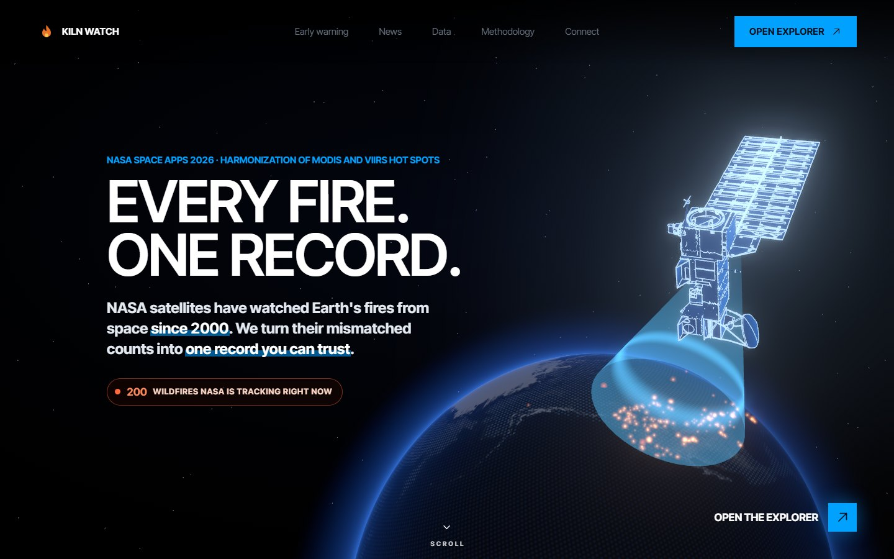</a>
</p>

<p align="center">
  <b>One fire record for any place on Earth, from 2000 to today, that does not jump when satellites change.</b><br>
  NASA Space Apps Challenge 2026 · <i>Harmonization of MODIS and VIIRS Hot Spots</i> · Team Off The Binary, Bangladesh
</p>

<h3 align="center">Live: <a href="https://kiln-watch-seven.vercel.app">kiln-watch-seven.vercel.app</a></h3>

<p align="center">
  <a href="https://kiln-watch-seven.vercel.app"></a>
  <a href="https://kiln-watch-seven.vercel.app/#pg=method"></a>
  <a href="https://kiln-watch-seven.vercel.app/#pg=mcp"></a>
</p>

<p align="center">
  
  
  
  
  
  
</p>

<p align="center">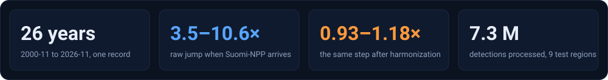</p>

<p align="center"><sub>The live demo serves the nine prebuilt regions. Run it locally to build any place on Earth.</sub></p>

<p align="center">
  <a href="#the-problem-in-one-picture">Problem</a> ·
  <a href="#the-fix">Fix</a> ·
  <a href="#the-proof">Proof</a> ·
  <a href="#the-product">Product</a> ·
  <a href="#who-it-is-for">Who it is for</a> ·
  <a href="#how-it-is-built">How it is built</a> ·
  <a href="#data-used">Data used</a> ·
  <a href="#use-of-ai">Use of AI</a> ·
  <a href="#references">References</a> ·
  <a href="#team-off-the-binary">Team</a>
</p>

---

## The problem, in one picture

In 2012 a sharper satellite started counting smaller fires. Nothing changed on the ground. The record did.

<p align="center">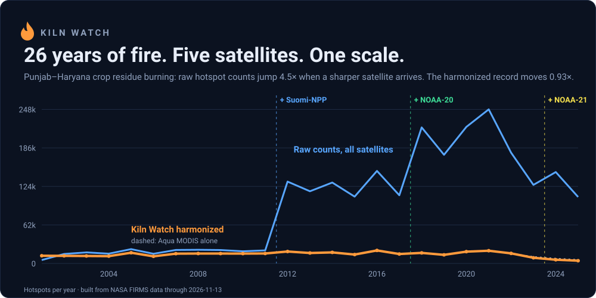</p>

<p align="center">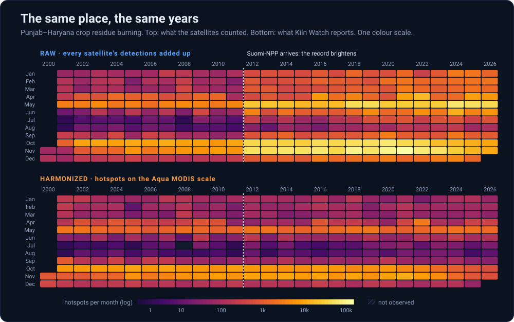</p>

## The fix

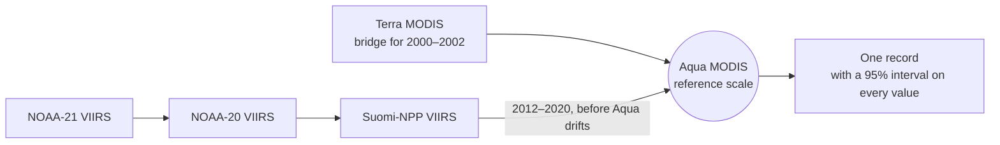

- **Why Aqua?** Its afternoon orbit is the only one flown continuously from 2002 through every VIIRS satellite.
- **How?** Ratio of totals per calendar month, day and night apart, shrunk by empirical Bayes. No black box.
- **Which satellites, when?** Read from the data. Suomi-NPP's end on 2 November 2026 was detected, not typed in.
- **What about Aqua's drift?** Its overpass time is read from the FIRMS timestamps, and the MODIS archive version from the
  data. Both changed in 2023 (the pass moved more than 15 minutes later; version 61.03 replaced 6.03). From 2023 the
  record runs on VIIRS alone, still on the Aqua 2002–2020 scale, so it carries on unchanged when Aqua is switched off.

<p align="center">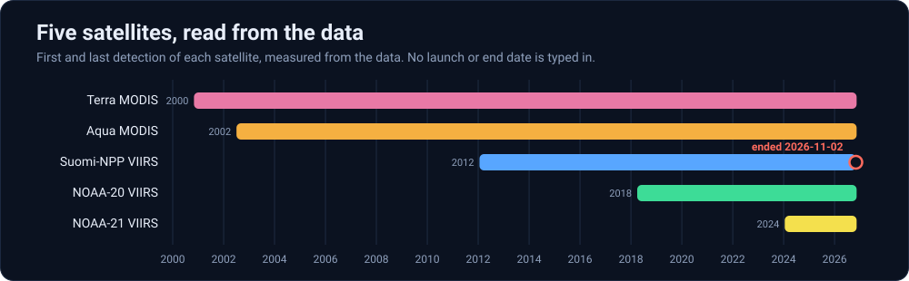</p>

## The proof

We test the record the way the future will: by taking satellites away.

<p align="center">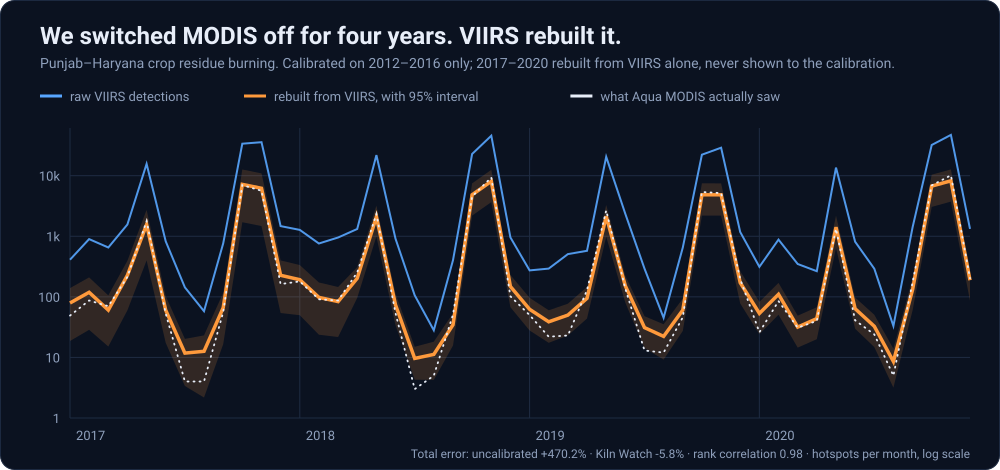</p>

<p align="center">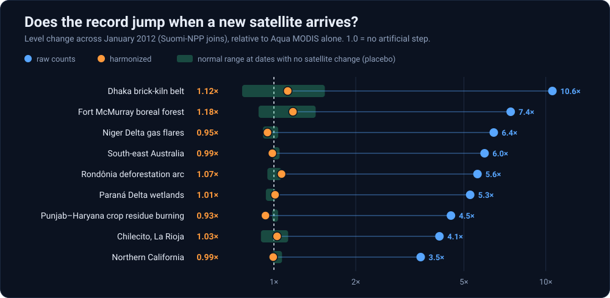</p>

<details>
<summary><b>Full results table, nine regions</b></summary>

<br>

| Region | Raw step ÷ Aqua | Harmonized step ÷ Aqua | Error, uncalibrated | Error, Kiln Watch | Rank ρ | Interval coverage, unwidened | Interval coverage, out of sample | Trend/yr raw | harmonized | Aqua only |
|---|---|---|---|---|---|---|---|---|---|---|
| Dhaka brick-kiln belt | 10.58 | 1.12 | +1865.3% | +13.1% | 0.68 | 42% | 88% | 0.7 | 0.0 | 0.0 |
| Punjab–Haryana crop residue burning | 4.48 | 0.93 | +469.7% | -5.8% | 0.98 | 94% | 92% | 72.5 | 0.0 | -0.1 |
| Chilecito, La Rioja | 4.06 | 1.03 | +812.3% | -9.7% | 0.89 | 35% | 96% | 2.5 | 0.0 | 0.0 |
| Rondônia deforestation arc | 5.61 | 1.07 | +516.5% | -0.6% | 0.98 | 77% | 96% | 18.1 | -0.1 | -0.2 |
| Fort McMurray boreal forest | 7.43 | 1.18 | +1030.3% | -8.9% | 0.83 | 58% | 96% | 1.7 | 0.0 | 0.0 |
| South-east Australia | 5.95 | 0.99 | +815.3% | +4.1% | 0.98 | 65% | 92% | 34.4 | -0.9 | -1.0 |
| Northern California | 3.47 | 0.99 | +782.9% | +8.1% | 0.98 | 67% | 79% | 33.5 | 1.0 | 0.7 |
| Paraná Delta wetlands | 5.27 | 1.01 | +597.0% | +27.5% | 0.94 | 79% | 92% | 6.0 | -1.6 | -1.7 |
| Niger Delta gas flares | 6.44 | 0.95 | +580.5% | -1.7% | 0.98 | 77% | 100% | 34.3 | 0.2 | 0.1 |

Errors are from the MODIS-denial test (calibrate on 2012–2016, rebuild 2017–2020 from VIIRS alone). Intervals are widened
so 95% of the 2017–2020 test months fall inside. To check that this is not circular, the widening is also fitted on
2017–2018 alone and tested on 2019–2020: that is the out-of-sample column. Trends are Sen slopes for 2003–2020.
How to read every column: the [Method page](https://kiln-watch-seven.vercel.app/#pg=method).

</details>

**Where it still falls short.** We publish these, not hide them.

- Five of nine regions land inside their no-change range. Punjab clearly misses: it still under-corrects by about 7%.
- Paraná Delta is off by +27%. Its record 2020 fire year is unlike anything the calibration years saw.
- Northern California's out-of-sample interval coverage is 79%: its intervals are too narrow for years unlike 2017–2018.
- No cloud-cover correction yet. The early-warning rule is now backtested per area (Warning page), but in sparse areas the
  scored months lean toward active ones, so its skill numbers there are not yet comparable across areas.

---

## The product

<table>
<tr>
<td width="50%" valign="top">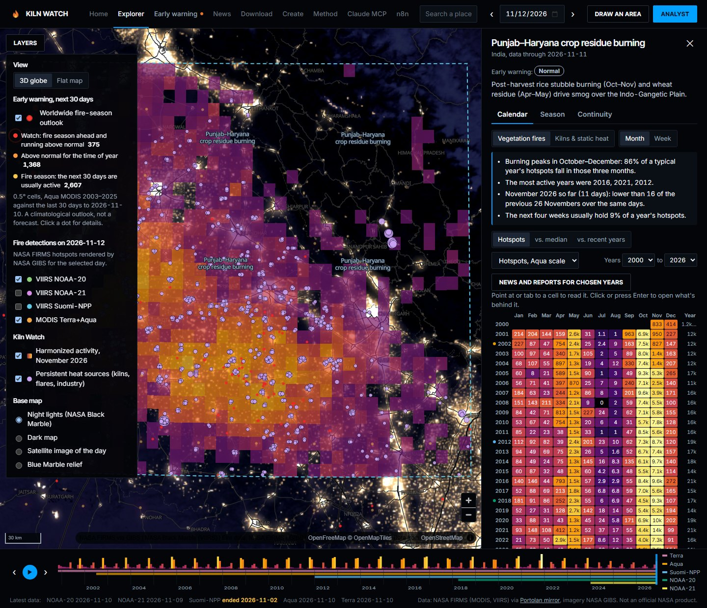<br><b>Burning calendar.</b> Month by year, number in every cell, colour-blind-safe, keyboard navigable. Click a cell for the detections behind it.</td>
<td width="50%" valign="top">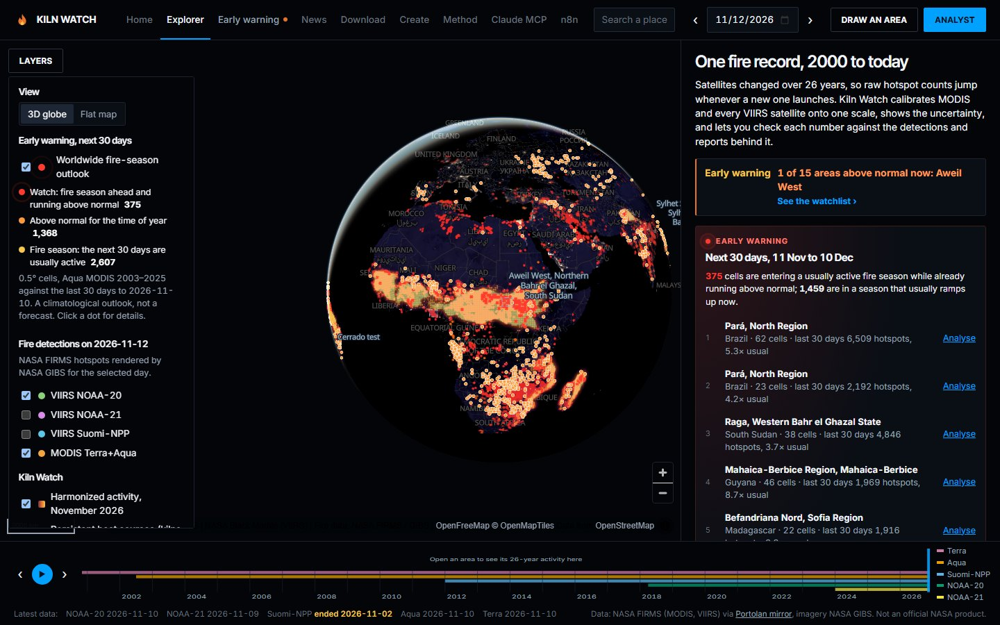<br><b>Globe and 30-day outlook.</b> Every half-degree cell on Earth: what the next 30 days usually bring, and how unusual the last 30 were.</td>
</tr>
<tr>
<td valign="top">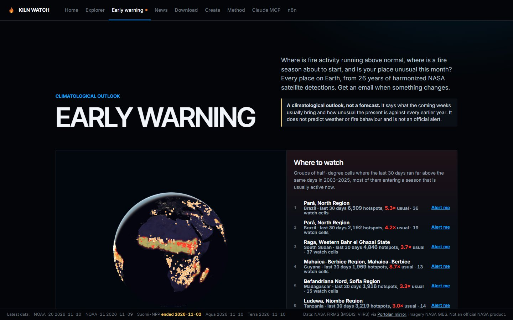<br><b>Early warning.</b> A plain rule printed on the page. It compares with earlier years; it never forecasts. Alerts by email or n8n.</td>
<td valign="top">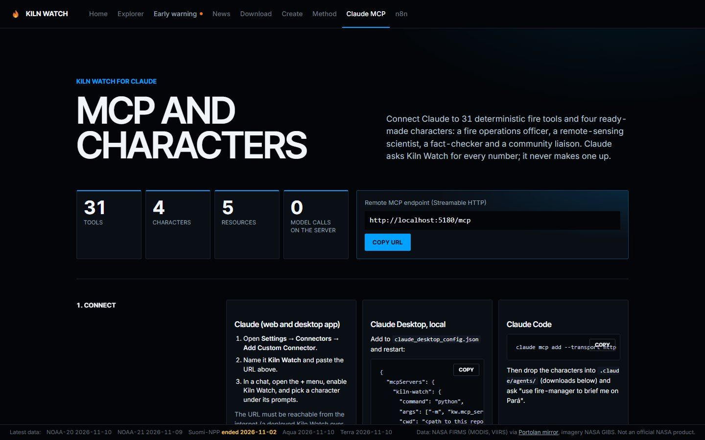<br><b>Ask it anything.</b> A Gemini analyst and a 31-tool MCP server for Claude. The model writes the words; every number comes from the pipeline.</td>
</tr>
</table>

Also in the box: draw-your-own area, weekly view, season start and peak, news and event reports beside the data, CSV and SVG downloads, a printable brief.

---

## Who it is for

| Anywhere on Earth | At home, in Bangladesh |
|---|---|
| **Fire managers** see whether this month is unusual against 26 comparable years, not 14. | **Dhaka's brick-kiln belt** is our home test case, and where raw counts mislead most: a 10.6× false jump. |
| **Scientists** get a record with intervals, provenance and the calibration table to download. | Kilns are small, hot and steady. VIIRS sees them; MODIS mostly cannot. |
| **Everyone after MODIS.** Terra and Aqua are near the end of their lives. The denial test shows the record carries on without them. | We separate them from vegetation fires, so a kiln season is never mistaken for a wildfire season. |

<p align="center">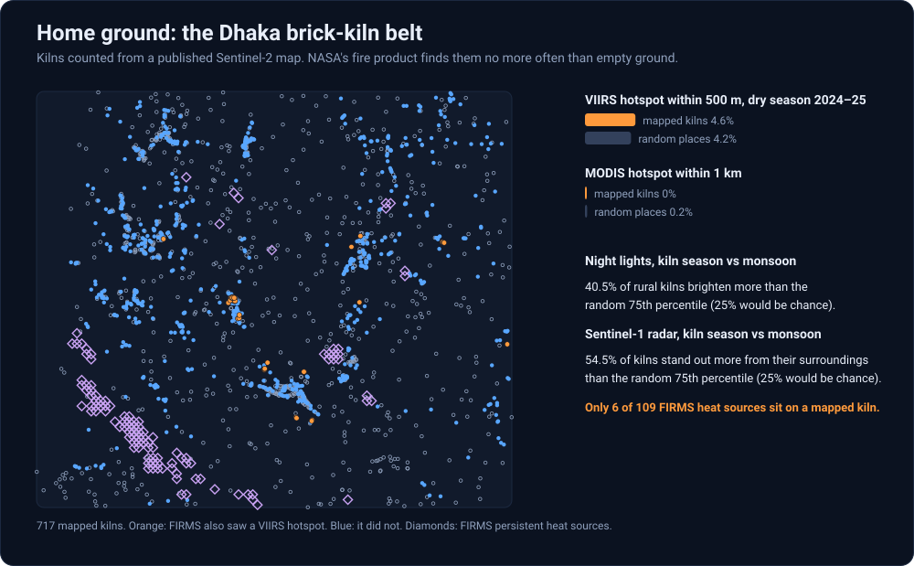</p>

<p align="center"><sub>Labelled "likely kilns": the cells are not yet checked against a kiln inventory. That check is next.</sub></p>

---

## How it is built

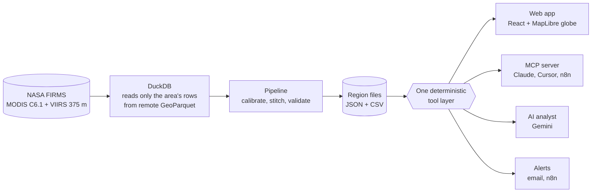

| For the judges | Where to look |
|---|---|
| **Best Use of Data** | Every number traces to FIRMS detections. Denial tests, placebo tests, measured interval coverage. Downloads for all of it. |
| **Best Use of Technology** | Remote GeoParquet queried in place. One tool layer behind the app, the AI analyst and a remote MCP endpoint. |
| **Galactic Impact** | A record that survives the end of MODIS, a worldwide outlook, and alerts for any box on Earth. |
| **Local Impact** | Bangladesh's kiln belt, separated from vegetation fire and tracked by season. |

<details>
<summary><b>Run it</b> (Python 3.11+, Node 20+)</summary>

```bash
cd server && pip install -r requirements.txt
uvicorn kw.api:app --port 8000        # built regions are committed: calendars work at once

cd web && npm install && npm run dev  # http://localhost:5173
```

Rebuild from NASA data: `python -m kw.firms && python -m kw.build`. Any-place builds in about 20 s: `python -m kw.globe` (one-off, 1.8 GB).
Tests: `python server/tests/test_science.py`. Figures on this page: `node scripts/readme_figures.mjs`.
Analyst key, MCP setup, email alerts and deployment: the [Connect page](https://kiln-watch-seven.vercel.app/#pg=mcp) and [CLAUDE.md](CLAUDE.md).

</details>

---

## Data used

Every number in Kiln Watch comes from NASA data.

### NASA data

| Dataset | Link | How we used it |
|---|---|---|
| FIRMS MODIS Collection 6.1 active fire (Terra, Aqua) | [earthdata.nasa.gov/firms](https://earthdata.nasa.gov/firms) | Every MODIS detection 2000–today; Aqua is the reference scale for the whole record |
| FIRMS VIIRS 375 m active fire, Collection 2 (Suomi-NPP) | [earthdata.nasa.gov/firms](https://earthdata.nasa.gov/firms) | Calibrated to Aqua on 2012–2020; Suomi-NPP's end date is read from the data |
| FIRMS VIIRS 375 m active fire, Collection 2 (NOAA-20) | [earthdata.nasa.gov/firms](https://earthdata.nasa.gov/firms) | Chained to Suomi-NPP so the record carries on after it |
| FIRMS VIIRS 375 m active fire, Collection 2 (NOAA-21) | [earthdata.nasa.gov/firms](https://earthdata.nasa.gov/firms) | Chained to NOAA-20 for the newest years |
| FIRMS archive as GeoParquet (Portolan mirror, CC0) | [source.coop/portolan-mirrors/firms-catalog](https://source.coop/portolan-mirrors/firms-catalog) | The same FIRMS records, queried in place with DuckDB, only the area's rows |
| GIBS Thermal Anomalies layers (MODIS combined; VIIRS SNPP, NOAA-20, NOAA-21 375 m) | [gibs.earthdata.nasa.gov](https://gibs.earthdata.nasa.gov) | Daily fire overlay on the map for the selected day |
| GIBS Corrected Reflectance True Color (MODIS Terra, VIIRS NOAA-20) | [gibs.earthdata.nasa.gov](https://gibs.earthdata.nasa.gov) | Satellite base map to see the place on the chosen day |
| Black Marble (VIIRS Day/Night Band) | [blackmarble.gsfc.nasa.gov](https://blackmarble.gsfc.nasa.gov) | Night-lights view on the globe; helps tell kilns and flares from wildfire |
| Blue Marble (shaded relief and bathymetry, Earth textures) | [visibleearth.nasa.gov](https://visibleearth.nasa.gov/collection/1484/blue-marble) | Globe base map and the 3D Earth on the home page |
| NASA 3D Resources: Aqua, Terra and Suomi-NPP models | [science.nasa.gov/3d-resources](https://science.nasa.gov/3d-resources/) | 3D satellites in the home-page story |
| EONET (Earth Observatory Natural Event Tracker) | [eonet.gsfc.nasa.gov](https://eonet.gsfc.nasa.gov) | Wildfire events shown beside the data for a month or cell |
| Worldview | [worldview.earthdata.nasa.gov](https://worldview.earthdata.nasa.gov) | "Open in Worldview" link for the same place and day |
| FIRMS Fire Map | [firms.modaps.eosdis.nasa.gov/map](https://firms.modaps.eosdis.nasa.gov/map) | Link to the raw detections for the same place and day |

### Other space agency data

None. NOAA-20 and NOAA-21 detections come through NASA FIRMS (listed above).

### Other datasets

| Dataset / API / library | Link | How we used it |
|---|---|---|
| GDACS (EC JRC, UN OCHA) | [gdacs.org](https://www.gdacs.org) | Wildfire alerts beside the data |
| GDELT DOC API | [gdeltproject.org](https://www.gdeltproject.org) | News reports for a place and month (2017+) |
| Google News RSS | [news.google.com](https://news.google.com) | More news reports for a place and month |
| ReliefWeb API (optional) | [reliefweb.int](https://reliefweb.int) | Humanitarian reports, when a key is set |
| OpenFreeMap | [openfreemap.org](https://openfreemap.org) | Vector base map |
| OpenStreetMap, Nominatim | [nominatim.org](https://nominatim.org) | Place search and place names |
| DuckDB | [duckdb.org](https://duckdb.org) | Reads remote GeoParquet in place |
| FastAPI, Uvicorn | [fastapi.tiangolo.com](https://fastapi.tiangolo.com) | API server |
| MCP Python SDK | [modelcontextprotocol.io](https://modelcontextprotocol.io) | 31-tool MCP server for Claude, Cursor and n8n |
| Google Gemini API | [ai.google.dev](https://ai.google.dev) | Optional in-app analyst |
| React, Vite, TypeScript | [react.dev](https://react.dev) | Web app |
| MapLibre GL JS | [maplibre.org](https://maplibre.org) | Map and globe |
| three.js, GSAP, Lenis | [threejs.org](https://threejs.org) | 3D home page, animation, smooth scroll |
| iso-kit (MIT) | `web/src/lib/` | Isometric drawing helpers |

We acknowledge the use of data and imagery from NASA's Fire Information for Resource Management System (FIRMS)
(https://earthdata.nasa.gov/firms), part of NASA's Earth Observing System Data and Information System (EOSDIS).

Detections are not fires and not burned area. Kiln Watch is an independent project, not an official NASA product.

---

## Use of AI

| Tool | Used for | Data it worked on |
|---|---|---|
| Claude Fable 5.2, Gemini Argon | Planning: brief, literature and rules review, method design | Public challenge page, papers, NASA/NOAA docs |
| Claude Opus (Claude Code), Gemini Flash | Developing and writing code, running builds and tests | Our source code; public FIRMS data |
| Gemini 2.5 Flash (optional, at run time) | In-app analyst that puts tool results into words | Pipeline output only; every tool call is shown |

No AI system produces any number in the calendar, charts or downloads. Details: [AI_USE.md](AI_USE.md).

---

## References

<details>
<summary><b>Papers, NASA documentation and challenge sources</b></summary>

<br>

**Challenge**
- [Harmonization of MODIS and VIIRS Hot Spots, challenge page](https://www.spaceappschallenge.org/2026/challenges/modis-and-viirs-hot-spots/?tab=details)

**Sensor status**
- [Transitioning from Suomi NPP VIIRS & OMPS: What FIRMS Users Need to Know](https://www.earthdata.nasa.gov/news/blog/transitioning-from-suomi-npp-viirs-omps-what-firms-users-need-know) (NASA Earthdata)
- [MODIS to VIIRS Transition](https://ladsweb.modaps.eosdis.nasa.gov/learn/modis-to-viirs-transition) (LAADS DAAC)
- [Aqua MODIS Acquisition Plan Through August 2026](https://lpdaac.usgs.gov/news/aqua-modis-acquisition-plan-through-august-2026/) (LP DAAC)
- [Terra orbital drift](https://modis-land.gsfc.nasa.gov/news.html) (MODIS Land)
- [VIIRS Instruments Become More Essential As Terra and Aqua Drift](https://www.earthdata.nasa.gov/news/feature-articles/viirs-instruments-become-more-essential-terra-aqua-drift-traditional-orbits) (NASA Earthdata)
- [NASA continuity workshop slides](https://www.earthdata.nasa.gov/s3fs-public/2023-03/RFI_TAA_continuity_workshop.pdf)
- [Drifting away from MODIS in the CAMS Global Fire Assimilation System](https://atmosphere.copernicus.eu/drifting-away-modis-cams-global-fire-assimilation-system)
- [NOAA-21 Active Fires provisional readme](https://www.star.nesdis.noaa.gov/JPSS/documents/AMM/N21/NOAA-21_Active_Fires_Provisional_Readme.pdf) · [NOAA-20 Active Fire maturity review](https://www.star.nesdis.noaa.gov/JPSS/documents/AMM/N20/Land_ActiveFires_Iband_Beta_Provisional.pdf)

**FIRMS data**
- [Active Fire Data Attributes for MODIS and VIIRS](https://www.earthdata.nasa.gov/data/tools/firms/active-fire-data-attributes-modis-viirs) · [FIRMS FAQ](https://www.earthdata.nasa.gov/data/tools/firms/faq)
- [VIIRS Collection 2 375 m Active Fire User Guide](https://ladsweb.modaps.eosdis.nasa.gov/archive/Document%20Archive/Science%20Data%20Product%20Documentation/VIIRS_C2_AF-375m_User_Guide_1.0.pdf)
- [MODIS Fire User Guide, Collection 6.1](https://lpdaac.usgs.gov/documents/1005/MOD14_User_Guide_V61.pdf)
- [Systematic Absence of Low-Confidence Nighttime Fire Detections in VIIRS (preprint)](https://arxiv.org/pdf/2510.26816)

**Harmonization science**
- [Observation operator and detection limits for MODIS and VIIRS FRP products (GMD, 2026)](https://gmd.copernicus.org/articles/19/10123/2026/)
- [Li et al. 2018, Comparison of FRP estimates from VIIRS and MODIS](https://agupubs.onlinelibrary.wiley.com/doi/full/10.1029/2017jd027823)
- [FRP correction and spatiotemporal fusion of MYD14 and VNP14IMG (Remote Sensing, 2026)](https://doi.org/10.3390/rs18101650)
- [MODIS versus VIIRS in Northeast Asia](https://doi.org/10.3390/rs12182870) · [FRP missed by MODIS in Africa](https://www.mdpi.com/2072-4292/12/10/1561) · [MODIS Aqua versus VIIRS in Punjab](https://pmc.ncbi.nlm.nih.gov/articles/PMC6108185/)
- [VFEIv0 VIIRS-based emission inventory](https://gmd.copernicus.org/articles/15/8085/2022/gmd-15-8085-2022.html) · [GFED5NRT (ESSD, 2026)](https://essd.copernicus.org/articles/18/7535/2026/)
- [Prior-based mask for persistent heat sources (Remote Sensing, 2026)](https://www.mdpi.com/2072-4292/18/6/904) · [GOFC-GWIS global static thermal anomalies](https://gofcgold.umd.edu/sites/default/files/2024-11/GOFC_GWIS_2024_Roberts_short.pdf)
- [ESA CCI Soil Moisture ATBD (CDF matching, triple collocation)](https://admin.climate.esa.int/media/documents/ESA_CCI_SM_RD_D2.1_v2_ATBD_v06.1_issue_1.1.pdf) · [Harmonized DMSP–VIIRS night lights](https://www.nature.com/articles/s41597-020-0510-y)

**Related tools**
- [NASA FEDS / fireatlas](https://earth-information-system.github.io/fireatlas/docs) · [Global Forest Watch fire data](https://blog.globalforestwatch.org/fires/wildfire-trends-gfw-fire-data/) · [Our World in Data, GWIS record](https://ourworldindata.org/grapher/annual-number-of-fires)

</details>

---

## Team Off The Binary

<p align="center"><i>From Bangladesh</i></p>

<table align="center">
<tr>
<td align="center" width="33%"><b>Aalvee Aarham</b><br><sub>AI SYSTEMS ARCHITECT & PROJECT LEAD</sub><br><a href="https://github.com/aalvee-aarham">@aalvee-aarham</a></td>
<td align="center" width="33%"><b>Israt Jahan Arna</b><br><sub>FRONTEND ENGINEERING LEAD</sub><br><a href="https://github.com/isratarna">@isratarna</a></td>
<td align="center" width="33%"><b>Sajid Alam Chowdhury Omee</b><br><sub>BACKEND SYSTEMS ENGINEER</sub><br><a href="https://github.com/omee1612">@omee1612</a></td>
</tr>
<tr>
<td align="center"><b>Nazifa Jahan</b><br><sub>RESEARCH & INNOVATION LEAD</sub><br><a href="https://github.com/nazifa-r">@nazifa-r</a></td>
<td align="center"><b>Maruf Hasan Tawhid</b><br><sub>DATA ACQUISITION & DATA ANALYST</sub><br><a href="https://github.com/tawhid-exe">@tawhid-exe</a></td>
<td align="center"><b>Muhammad Ahnaf Sarker</b><br><sub>LEAD AI/ML DEVELOPER</sub><br><a href="https://github.com/Ahnaf181419">@Ahnaf181419</a></td>
</tr>
</table>
