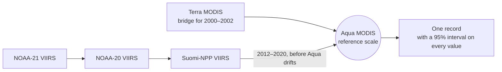
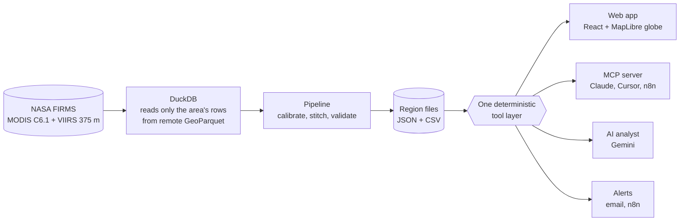

<h1 align="center">Kiln Watch</h1>

<p align="center">
  <a href="https://kiln-watch-seven.vercel.app"></a>
</p>

<p align="center">
  <b>One fire record for any place on Earth, from 2000 to today, that does not jump when satellites change.</b><br>
  NASA Space Apps Challenge 2026 · <i>Harmonization of MODIS and VIIRS Hot Spots</i> · Team Off The Binary, Bangladesh
</p>

<h3 align="center">Live: <a href="https://kiln-watch-seven.vercel.app">kiln-watch-seven.vercel.app</a></h3>

<p align="center">
  <a href="https://kiln-watch-seven.vercel.app"></a>
  <a href="https://kiln-watch-seven.vercel.app/#pg=method"></a>
  <a href="https://kiln-watch-seven.vercel.app/#pg=mcp"></a>
</p>

<p align="center">
  
  
  
  
  
  
</p>

<p align="center"></p>

<p align="center"><sub>Demo video: link added after upload (see <code>docs/demo/SUBMISSION.md</code>).</sub></p>

<p align="center"><sub>The live demo serves the nine prebuilt regions. Run it with Docker (the same image runs on Azure, see "Two hosts, one site") to build any place on Earth.</sub></p>

<p align="center">
  <a href="#the-problem-in-one-picture">Problem</a> ·
  <a href="#the-fix">Fix</a> ·
  <a href="#the-proof">Proof</a> ·
  <a href="#open-questions-from-nasas-discussions">Open questions</a> ·
  <a href="#the-product">Product</a> ·
  <a href="#who-it-is-for">Who it is for</a> ·
  <a href="#how-it-is-built">How it is built</a> ·
  <a href="#data-used">Data used</a> ·
  <a href="#use-of-ai">Use of AI</a> ·
  <a href="#references">References</a> ·
  <a href="#team-off-the-binary">Team</a>
</p>

---

## The problem, in one picture

In 2012 a sharper satellite started counting smaller fires. Nothing changed on the ground. The record did.

<p align="center"></p>

<p align="center"></p>

## The fix



- **Why Aqua?** Its afternoon orbit is the only one flown continuously from 2002 through every VIIRS satellite.
- **How?** Ratio of totals per calendar month, day and night apart, shrunk by empirical Bayes. No black box. [Why this method](#why-this-method).
- **Which satellites, when?** Read from the data. Suomi-NPP's end on 2 November 2026 was detected, not typed in.
- **What about Aqua's drift?** Its overpass time is read from the FIRMS timestamps, and the MODIS archive version from the
  data. Both changed in 2023 (the pass moved more than 15 minutes later; version 61.03 replaced 6.03). From 2023 the
  record runs on VIIRS alone, still on the Aqua 2002–2020 scale, so it carries on unchanged when Aqua is switched off.

<p align="center"></p>

## The proof

We test the record the way the future will: by taking satellites away.

<p align="center"></p>

<p align="center"></p>

<details>
<summary><b>Full results table, nine regions</b></summary>

<br>

| Region | Raw step ÷ Aqua | Harmonized step ÷ Aqua | Error, uncalibrated | Error, Kiln Watch | Rank ρ | Interval coverage, unwidened | Interval coverage, out of sample | Trend/yr raw | harmonized | Aqua only |
|---|---|---|---|---|---|---|---|---|---|---|
| Dhaka brick-kiln belt | 10.58 | 1.12 | +1767.3% | +13.1% | 0.68 | 42% | 88% | 1.5 | 0.0 | 0.0 |
| Punjab–Haryana crop residue burning | 4.48 | 0.93 | +470.2% | -5.8% | 0.98 | 94% | 92% | 70.0 | 0.1 | -0.2 |
| Chilecito, La Rioja | 4.06 | 1.03 | +812.2% | -9.7% | 0.89 | 35% | 96% | 3.3 | -0.0 | -0.0 |
| Rondônia deforestation arc | 5.61 | 1.07 | +515.8% | -0.6% | 0.98 | 77% | 96% | 51.7 | -0.1 | -0.3 |
| Fort McMurray boreal forest | 7.43 | 1.18 | +1032.3% | -8.9% | 0.83 | 58% | 96% | 1.3 | 0.0 | 0.0 |
| South-east Australia | 5.95 | 0.99 | +813.7% | +4.1% | 0.98 | 65% | 92% | 38.7 | -0.9 | -1.0 |
| Northern California | 3.47 | 0.99 | +785.4% | +8.1% | 0.98 | 67% | 79% | 29.3 | 1.2 | 1.2 |
| Paraná Delta wetlands | 5.27 | 1.01 | +596.1% | +27.5% | 0.94 | 79% | 92% | 7.3 | -1.5 | -1.7 |
| Niger Delta gas flares | 6.44 | 0.95 | +569.9% | -1.7% | 0.98 | 77% | 100% | 73.0 | 0.3 | 0.1 |

Errors are from the MODIS-denial test (calibrate on 2012–2016, rebuild 2017–2020 from VIIRS alone). Intervals are widened
so 95% of the 2017–2020 test months fall inside. To check that this is not circular, the widening is also fitted on
2017–2018 alone and tested on 2019–2020: that is the out-of-sample column. Trends are seasonal Sen slopes for
2003–2020: the median of the per-season Sen slopes, which is what a seasonal test should report, not the pooled slope
over all months.
How to read every column: the [Method page](https://kiln-watch-seven.vercel.app/#pg=method).

</details>

### Why this method

- **Measured on what we publish.** The sensor gap is measured on monthly detection totals, the quantity in the record, so no
  model of fire physics has to be right first. VIIRS sees many small fires MODIS cannot ([Schroeder et al. 2014](https://doi.org/10.1016/j.rse.2013.12.008);
  [Giglio et al. 2016](https://doi.org/10.1016/j.rse.2016.02.054)), and the ratio absorbs that difference as it is.
- **A ratio of totals, not a regression.** Both sensors count with error, so regressing one on the other biases the slope
  toward zero ([regression dilution, Frost & Thompson 2000](https://doi.org/10.1111/1467-985X.00164)). For Poisson counts with
  a common rate ratio, the ratio of totals is its maximum-likelihood estimate.
- **Seasonal, not over-fitted.** One ratio per calendar month, shrunk toward the all-year ratio by empirical Bayes
  ([Efron & Morris 1975](https://doi.org/10.1080/01621459.1975.10479864)), with the between-month variance estimated by the
  method of moments ([DerSimonian & Laird 1986](https://doi.org/10.1016/0197-2456(86)90046-2)).
- **No near-simultaneous pairs needed.** Fire-by-fire or pixel matching needs the two satellites to look within minutes.
  Aqua's pass has drifted later since 2020, so such pairs become rare. Monthly totals only need both satellites in orbit that month.
- **Tested by taking satellites away**, with intervals widened by split conformal prediction
  ([Lei et al. 2018](https://doi.org/10.1080/01621459.2017.1307116)) and checked out of sample. Trends use
  [Sen's slope (1968)](https://doi.org/10.1080/01621459.1968.10480934).

Each part is a published, standard tool. The way they are combined for MODIS and VIIRS is ours, and the tests above are its proof.

**The main alternative was tried, and lost.** MODIS detects a fire only above a certain fire power, so the sensor ratio could
follow the fire mix. We added a term for the month's mean Suomi-NPP fire power per detection to the Suomi-NPP → Aqua ratio,
fitted on 2012–2016 and scored on 2017–2020 (`transfer_validation.fire_size_term` in each `meta.json`):

| | Ratio per calendar month (ours) | Plus a fire-size term |
|---|---|---|
| Mean absolute log error, 9 areas | **0.459** | 0.460 |
| Areas where it lowers the log error | – | 3 of 9 (Fort McMurray, Rondônia, south-east Australia) |
| Areas where it raises the error in detections | – | 6 of 9 |
| Bias, Northern California / Paraná Delta | +21.0% / +36.9% | +50.1% / +140.2% |

It helps in some large-fire areas, but its slope does not hold from the training years to the test years elsewhere, so it is
not used. An area-specific version is an open next step.

**Where it still falls short.** We publish these, not hide them.

- Five of nine regions land inside their no-change range. Punjab clearly misses: it still under-corrects by about 6%.
- Paraná Delta is off by +27%. Its record 2020 fire year is unlike anything the calibration years saw.
- Northern California's out-of-sample interval coverage is 79%: its intervals are too narrow for years unlike 2017–2018.
- No cloud-cover correction yet. The early-warning rule is now backtested per area (Warning page), but in sparse areas the
  scored months lean toward active ones, so its skill numbers there are not yet comparable across areas.
- The 30-day outlook now runs on NOAA-20 VIIRS put on the Aqua scale, so it does not stop with Aqua. Held out on 2022 the
  total is off by +0.9% and the cell ranking agrees at ρ = 0.84, but its "above normal" flag agrees with Aqua's own on only
  41% of cells (NOAA-20 finds 681 of Aqua's 1,325 and adds 318): the two satellites sample different small fires. A single
  dot is a hint; the named regions group neighbouring cells. Other shrinkage weights gave 38–42%, so this is not a tuning issue.
- The casebook's news witness is only as good as GDELT (2017 on) and Google News; GDACS wildfire events start in 2021. A witness
  that could not look is shown as "could not look" with its reason, never as "nothing found". MODIS burned area is guided by
  MODIS hotspots, so it is not fully independent of the record. Event points are matched to hotspots in their cell, the 8 around
  it and the next month: those windows are judgement calls.
- Kilns: the kiln map shows structures from the 2024-25 dry season, not kilns in operation, and is licensed non-commercial.
  Night lights and Sentinel-1 radar are consistent with kilns, not proof of them, and neither says whether a kiln is firing.

**Checked against other data.** Two checks run outside the pipeline and publish their results, whether they pass or not.

| Check | What it asks | Result |
|---|---|---|
| NASA MCD64A1 burned area, seven areas, 261–263 months each, 2003–2024 | Does the record track physical burned area, and is the 2012 jump real? | The raw detection count jumps ×4.89 in 2012; the harmonized record moves ×1.03; burned area, built from MODIS alone, moves ×0.72. The jump was an instrument change. Monthly rank correlation with burned area: 0.49 harmonized, 0.37 raw. |
| APAD Bangladesh brick-kiln inventory, 4,760 operating kilns | Do the published persistent-heat cells correspond to mapped kilns? | No. At 1 km, 2 of 109 cells land on a kiln where randomly placed cells of the same number would land on 8.3%. The layer is a persistent-heat proxy, not a kiln inventory. |

Both are re-runnable (`scripts/validation/`), fail closed, and publish their sources, hashes and limitations with the
numbers: `data/validation/burned_area.json`, `data/validation/kilns_dhaka-kilns.json`.

---

## Open questions from NASA's discussions

We read every thread about this challenge on NASA's Space Apps GitHub (14 November 2026). For each question, the table gives our
answer. The full page, with tables built from the data, is
[Open questions](https://kiln-watch-seven.vercel.app/#pg=questions).

| Thread | Question | Our answer | Status |
|---|---|---|---|
| [#1879](https://github.com/nasa/spaceapps/discussions/1879) | MODIS- or VIIRS-equivalent? (reply: either, if justified) | Aqua MODIS scale. Converting VIIRS down is well-posed; going up would invent small fires. The VIIRS-scale view marks pre-2012 months *modelled* | Built in |
| [#1879](https://github.com/nasa/spaceapps/discussions/1879) | Standard FIRMS archive, or swath products? (reply: FIRMS) | FIRMS standard and near-real-time. NRT rows have no `type` flag, so cells are typed from their standard-processing history; NRT months are *provisional* | Built in |
| [#1879](https://github.com/nasa/spaceapps/discussions/1879) | Suomi-NPP stopped; continuity with NOAA-20/21? (reply: yes) | The question says 2 Nov 2022. The data says Suomi-NPP's last day is **2026-11-02**, detected rather than typed in. NASA's own pages disagree on the hour (FIRMS blog 13:00 UTC, FIRMS FAQ 15:40 UTC); we count days, so the record does not depend on it. The chain NOAA-21 → NOAA-20 → Suomi-NPP → Aqua carries the record on | Built in |
| [#1879](https://github.com/nasa/spaceapps/discussions/1879) | Users and time step? (reply: responders to scientists; monthly solid, weekly if readable) | Monthly calendar by default, a weekly grid one switch away, daily detections behind every cell | Built in |
| [#1879](https://github.com/nasa/spaceapps/discussions/1879) | Is Earth Engine acceptable? (reply: yes, prefer NASA resources) | The fire record uses FIRMS only. Earth Engine is used at build time for witnesses (MCD64A1, Black Marble, Sentinel-1) | Built in |
| [#1786](https://github.com/nasa/spaceapps/discussions/1786) | Off-nadir pixels grow to about 2 km. How to harmonize? | **Measured**, 2012–2020. Where fire is frequent, the share of Aqua detections in the outer half of the swath moves ±3–5 points a year, and Suomi-NPP ÷ Aqua is the same in the inner and outer halves (Punjab 5.8 and 5.8). So a ratio of monthly totals absorbs it. In event-driven seasons it does not: Fort McMurray ±17 points, outer ratio 16.5 against 9.3 inner | Measured; not yet stratified |
| [#1786](https://github.com/nasa/spaceapps/discussions/1786) | Some hotspots only VIIRS sees, some only MODIS | **Measured**: 40–91% of Aqua detections have a Suomi-NPP detection within about 1 km on the same day and pass; only 5–56% of Suomi-NPP detections have an Aqua one. The VIIRS-only ones are small fires (median FRP 1.9–4.9 MW against 5.4–12.8 MW matched). We calibrate totals, never pair points, so they are kept | Measured |
| [#1786](https://github.com/nasa/spaceapps/discussions/1786) | The global CSV is about 45 GB. Global, or one place? | DuckDB reads only an area's rows from remote GeoParquet. Nine areas are prebuilt; any box up to 16 square degrees can be built on demand | Built in |
| [#2016](https://github.com/nasa/spaceapps/discussions/2016), [#1959](https://github.com/nasa/spaceapps/discussions/1959) | One region? Own FIRMS downloads? (replies: yes; document them) | Nine areas plus draw-your-own. Every file records products, versions, period, box and code version | Built in |
| [#1879](https://github.com/nasa/spaceapps/discussions/1879) (reply) | Cloud: no detection may mean no clear view | **Not solved yet.** We divide by the days each satellite observed, not by cloud-free views. Next step: use the cloud class of the MYD14A1 fire mask as a clear-sky denominator | Open |

**Raised elsewhere, in NASA pages and papers:**

| Source | Problem | Our answer | Status |
|---|---|---|---|
| [Earthdata alert](https://www.earthdata.nasa.gov/data/alerts-outages/transition-from-modis-viirs), [CAMS](https://atmosphere.copernicus.eu/drifting-away-modis-cams-global-fire-assimilation-system) | Terra and Aqua are drifting and will stop (CAMS: Terra January 2027, Aqua around September 2027) | Aqua's drift onset is measured from FIRMS timestamps; from it the record runs on VIIRS on the Aqua scale. Tested by switching MODIS off | Built in |
| [FIRMS blog](https://www.earthdata.nasa.gov/news/blog/transitioning-from-suomi-npp-viirs-omps-what-firms-users-need-know) | Terra is the only morning overpass; NASA is "investigating alternatives" | The record is defined on Aqua's afternoon and post-midnight passes, which NOAA-20/21 continue, so it stays consistent. But it never measured morning burning, and nothing here replaces Terra | Open |
| [FIRMS FAQ](https://www.earthdata.nasa.gov/data/tools/firms/faq) | NRT differs from standard data: geolocation, no type, day/night by orbit direction instead of solar zenith | NRT months are *provisional* and typed from cell history. The day/night rule is not reconciled, so at high latitudes a provisional month can put detections in the other half | Partly |
| [Li et al. 2018](https://agupubs.onlinelibrary.wiley.com/doi/full/10.1029/2017jd027823) | VIIRS FRP about 47% lower than MODIS for large boreal fires | We harmonize counts, not FRP. FRP totals must not be compared across the 2012 switch | Open |
| [arXiv 2510.26816](https://arxiv.org/pdf/2510.26816) | Low-confidence VIIRS detections systematically absent at night | VIIRS low confidence is dropped day and night alike; day and night are calibrated apart | Built in |
| [GMD 2026](https://gmd.copernicus.org/articles/19/10123/2026/) | Detection probability varies by region (under 30% for MODIS in some equatorial areas) | Each area has its own calibration. Where both sensors miss (cloud, short fires) the record stays low in every year: the cloud item above | Partly |

Every other limitation is listed on the [Proof page](https://kiln-watch-seven.vercel.app/#pg=method) and under "Where it still
falls short" above. A question we have not answered? Use the
[contact form](https://kiln-watch-seven.vercel.app/#pg=contact) or [open an issue](https://github.com/Aalvee-Aarham/nasaspaceappschallenge-2026-team-off-the-binary/issues/new).

`nasa/MODIS-VIIRS-Data-Resources` holds access tutorials. Its five issues are closed documentation pull requests, none about
harmonization. Re-run the checks with `python scripts/discussion_checks.py` (writes `data/regions/discussion_checks.json`).

---

## The product

<table>
<tr>
<td width="50%" valign="top"><br><b>Burning calendar.</b> Month by year, number in every cell, colour-blind-safe, keyboard navigable. Click a cell for the detections behind it.</td>
<td width="50%" valign="top"><br><b>Globe and 30-day outlook.</b> Every half-degree cell on Earth: what the next 30 days usually bring, and how unusual the last 30 were.</td>
</tr>
<tr>
<td valign="top"><br><b>Early warning.</b> A plain rule printed on the page. It compares with earlier years; it never forecasts. Alerts by email or n8n.</td>
<td valign="top"><br><b>Ask it anything.</b> A Gemini analyst and a 40-tool MCP server for Claude. The model writes the words; every number comes from the pipeline.</td>
</tr>
</table>

**Is fire near you? (Cases & exposure page).** Type any town, village, school or address on Earth, or press
"Use my location". In about ten seconds the page answers in plain words and pictures, for families and students as much
as for fire managers and safety officers: a traffic-light level (fire close by, stay alert, fire season, low right now),
the fire spots NASA satellites saw within 5, 10 or 25 km in the last 7 days, on a street map, how many of the last 23
years had fire there this month, and the 30-day outlook. Then the schools, hospitals, clinics, care homes and fire
stations around the place (OpenStreetMap), each with its distance to the nearest fire seen this week, and a one-click
alert. No study area is needed: the fire months come from a 10 MB worldwide table built from the global FIRMS aggregate
(`data/global/fire_season.parquet`, MODIS 2003-2025, one bit per year per calendar month per 0.1° cell), and the last
7 days are read live from the public FIRMS mirror. Every source that could not answer says so; it is never shown as "no
fire". A detection is heat seen from space, not a confirmed fire; history is not a forecast; this is not an official
warning. The rule (`science.place_level`) is printed on the page.

```bash
curl "https://kiln-watch.purplegrass-ce2aa2d8.eastasia.azurecontainerapps.io/api/place-risk?q=Ludhiana,%20India&radius_km=10"
```

Same answer for Claude through the MCP tool `check_place_fire_risk`; every endpoint is listed at `/docs` on the API.

**Nine study areas in depth.** Each fire case is heard by six witnesses (the satellite record, a MODIS-against-VIIRS check, NASA EONET, GDACS, MODIS burned area, the news) and gets a plain verdict. Each witness that could not look says why. Beside it: how many people, hospitals and schools sit in the cells where fire was seen (context, never impact).

**Bangladesh.** The Dhaka kiln belt is counted from a published kiln map and night lights, with NASA's fire product measured against it, not used to find kilns.

Also in the box: draw-your-own area, weekly view, season start and peak, news and event reports beside the data, CSV, TSV and JSON downloads where you pick the columns, years and format (Explorer panel, `/api/regions/{id}/export`, MCP `export_data`), SVG charts, a printable brief.

**Download exactly what you need.** Any built area, including one you drew, exports as CSV, TSV or JSON. You choose the table
(the monthly or weekly calendar, or the individual detections for up to a year), the years or dates, and the column groups
(harmonized hotspots with intervals, history against other years, satellites and coverage, raw counts, quality flags). The same
choices are in the Explorer panel (Download), on the Download page, in the API and in MCP (`export_data`, which lists the column
groups and asks you which you want). Files start with `#` comment lines (unit, source, code version) unless you switch them off;
JSON carries the same provenance in a block. Raw per-satellite counts are optional and labelled: they rise whenever a satellite is added.

```bash
BASE=https://kiln-watch.purplegrass-ce2aa2d8.eastasia.azurecontainerapps.io
curl "$BASE/api/export/options"                      # formats, column groups, limits
curl -o punjab.csv "$BASE/api/regions/punjab/export?columns=hotspots,history&start=2015&end=2025"
curl -o hot.json  "$BASE/api/regions/punjab/export?kind=detections&format=json&columns=where,strength&start=2025-04-01&end=2025-04-30&used_only=true"
```

---

## Who it is for

| Anywhere on Earth | At home, in Bangladesh |
|---|---|
| **Fire managers** see whether this month is unusual against 26 comparable years, not 14. | **Dhaka's brick-kiln belt** is our home test case, and where raw counts mislead most: a 10.6× false jump. |
| **Scientists** get a record with intervals, provenance and the calibration table to download. | **NASA's fire product cannot count kilns, so we do not ask it to.** We measured it: of 717 kilns on a published Sentinel-2 kiln map, 4.6% had a VIIRS hotspot within 500 m in the 2024-25 dry season, against 4.2% of random places far from any kiln. MODIS: 0% against 0.2%. |
| **Everyone after MODIS.** Terra and Aqua are near the end of their lives. The denial test shows the record carries on without them, and the 30-day outlook is now counted by NOAA-20 VIIRS, so it does not stop with Aqua. | Kilns are counted from the kiln map and checked against NASA Black Marble night lights: 40.5% of rural kilns brighten more between the monsoon and the dry season than the random 75th percentile (25% would be chance). Sentinel-1 radar agrees: a mapped kiln's contrast with its surroundings rises a median 0.67 dB from the monsoon to the dry season (random places: 0.03 dB), and 54.5% of kilns are above the random 75th percentile. Only 6 of the 109 FIRMS "persistent heat sources" sit on a mapped kiln, so we stopped calling them kilns. |

<p align="center"></p>

<p align="center"><sub>The map shows kiln structures in the 2024-25 dry season, not kilns in operation; about 8 in 10 detections inside human-labelled footprints are kilns, about 2 in 10 outside. Licence CC BY-NC 4.0 (non-commercial). Night lights and radar are consistent with kilns, not proof: kilns sit on town edges that also brighten in winter, and radar also responds to buildings and moisture. A second, independently licensed inventory (APAD, CC BY 4.0) reaches the same conclusion about the persistent-heat cells: see <a href="#checked-against-other-data">Checked against other data</a>.</sub></p>

---

## How it is built



| For the judges | Where to look |
|---|---|
| **Best Use of Data** | Every fire number traces to FIRMS detections. Denial tests, placebo tests, measured interval coverage; fire cases heard by six witnesses (EONET, GDACS, MODIS burned area, news); kilns from a published map and Black Marble. Downloads for all of it. |
| **Best Use of Technology** | Remote GeoParquet queried in place. One tool layer behind the app, the AI analyst and a remote MCP endpoint. Earth Engine at build time only (MODIS burned area, Black Marble, Sentinel-1), so the live demo needs none. |
| **Galactic Impact** | A record that survives the end of MODIS, a worldwide outlook now counted by NOAA-20 with its held-out error published, and alerts for any box on Earth. |
| **Local Impact** | Bangladesh's kiln belt: we measured that NASA's fire product cannot count kilns (4.6% of mapped kilns against 4.2% of random ground) and count them from a published map, checked by night lights and Sentinel-1 radar. |

<details>
<summary><b>Run it</b> (Python 3.11+, Node 20+)</summary>

```bash
cd server && pip install -r requirements.txt
uvicorn kw.api:app --port 8000        # built regions are committed: calendars work at once

cd web && npm install && npm run dev  # http://localhost:5173
```

Rebuild from NASA data: `python -m kw.firms && python -m kw.build`. Any-place builds in about 20 s once `python -m kw.globe` has run (one-off, 1.8 GB). Without it, as on the hosted server, the first build of a drawn area takes 5 to 10 minutes: it reads 26 yearly files, 4 at a time (`KW_FETCH_WORKERS`; 8 measured slower). The time depends on the years, not the box size.
Casebook witnesses (build time only; needs `pip install earthengine-api`, `earthengine authenticate` and `EE_PROJECT` in a git-ignored `.env`):
`python scripts/build_burned.py && python -m kw.cases` (burned area), `python scripts/build_kilns.py` (Dhaka kiln evidence, needs `python -m kw.firms` first).
The outlook (`python -m kw.outlook`) needs the global aggregate from `python -m kw.globe`.
The worldwide fire months behind "Is fire near you?" (`data/global/fire_season.parquet`, committed): `python -m kw.globe season`.
Tests: `python server/tests/test_science.py` (also `test_cases.py`, `test_api.py`). Figures on this page: `node scripts/readme_figures.mjs`.
Record-level independent checks: `python scripts/validation/kilns.py` and `uv run --with rasterio --with numpy --with planetary-computer python scripts/validation/burned_area.py` (results committed in `data/validation/`).
Analyst keys: set `GEMINI_API_KEY` and optional fallbacks `GEMINI_API_KEYS=key2,key3,...` in a git-ignored `.env` (and as
secrets on Azure and Vercel). The analyst moves to the next key when one hits its free-tier quota, is overloaded or is
refused, and uses the `gemini-flash-latest` alias so a retired model version does not break it. Never commit keys.
MCP setup, email alerts and deployment: the [Connect page](https://kiln-watch-seven.vercel.app/#pg=mcp) and [CLAUDE.md](CLAUDE.md).
Contact form: messages go to `POST /api/feedback` and are appended to `data/feedback.jsonl` (git-ignored). With the SMTP
settings and `CONTACT_EMAILS` (comma-separated) set, each one is also mailed. The read-only Vercel copy refuses it, and on
Azure the file lasts only as long as the replica, so set the emails before relying on it.

**Two hosts, one site.** Vercel serves the site and a read-only API (its functions stop after a minute, too short for a
build). The full app (`Dockerfile`, site + API on port 7860, live builds on) runs on Azure Container Apps:
<https://kiln-watch.purplegrass-ce2aa2d8.eastasia.azurecontainerapps.io>. The Vercel project sets
`VITE_API_BASE` to that address, so the site sends every request to Azure and falls back to Vercel's own read-only API
when Azure does not answer `/api/health` within 15 s.

| Piece | Where | Notes |
|---|---|---|
| Container App `kiln-watch` | resource group `kiln-watch-rg`, East Asia (Azure for Students allows only five Asian/UAE regions) | 1 vCPU, 2 GiB, 0–1 replica: scales to zero when idle, never more than one copy (builds live on its disk) |
| Registry `kilnwatch1114.azurecr.io` | same group, Basic tier | about US$5/month from student credits; the app itself stays inside the Container Apps free monthly grant for a demo |
| Image build | GitHub Actions, `.github/workflows/azure-image.yml` | Azure for Students blocks ACR Tasks, so GitHub builds the image on every push to `main` that touches the app (secrets `ACR_USERNAME`, `ACR_PASSWORD`) |
| Environment `kiln-watch-env` | same group | logs off (Log Analytics is billed) |

Checked after deploy: health answers with `serverless: false`, the Vercel origin gets CORS, and a live 1°×1° build
(northern Thailand) finished in about 5 minutes with the same Aqua drift onset (2023-01) as the prebuilt areas.
That build read the 26 yearly files one at a time. They are now read four at a time (`KW_FETCH_WORKERS`; eight was slower on a
local test), which took a full 27-year fetch on a development machine from an estimated 3.5 minutes (27 years at about 8 s) to 90 s, with identical rows. The Azure timing after this change has
not been measured yet, so the site promises 5 to 10 minutes.

Limits: the first request after idle waits a few seconds while a replica starts; an area built live lasts until the
replica stops (the nine prebuilt areas are in the image). The workflow pushes images but does not roll them out; after
it finishes run
`az containerapp update -n kiln-watch -g kiln-watch-rg --image kilnwatch1114.azurecr.io/kiln-watch:<commit sha>`.
Hugging Face Spaces would also run this `Dockerfile`, but Docker Spaces now need a PRO account.

</details>

---

## Data used

Every fire number in Kiln Watch comes from NASA data. The kiln map is the one outside number, and it is labelled as such.

### NASA data

| Dataset | Link | How we used it |
|---|---|---|
| FIRMS MODIS Collection 6.1 active fire (Terra, Aqua) | [earthdata.nasa.gov/firms](https://earthdata.nasa.gov/firms) | Every MODIS detection 2000–today; Aqua is the reference scale for the whole record |
| FIRMS VIIRS 375 m active fire, Collection 2 (Suomi-NPP) | [earthdata.nasa.gov/firms](https://earthdata.nasa.gov/firms) | Calibrated to Aqua on 2012–2020; Suomi-NPP's end date is read from the data |
| FIRMS VIIRS 375 m active fire, Collection 2 (NOAA-20) | [earthdata.nasa.gov/firms](https://earthdata.nasa.gov/firms) | Chained to Suomi-NPP so the record carries on after it |
| FIRMS VIIRS 375 m active fire, Collection 2 (NOAA-21) | [earthdata.nasa.gov/firms](https://earthdata.nasa.gov/firms) | Chained to NOAA-20 for the newest years |
| FIRMS archive as GeoParquet (Portolan mirror, CC0) | [source.coop/portolan-mirrors/firms-catalog](https://source.coop/portolan-mirrors/firms-catalog) | The same FIRMS records, queried in place with DuckDB, only the area's rows |
| GIBS Thermal Anomalies layers (MODIS combined; VIIRS SNPP, NOAA-20, NOAA-21 375 m) | [gibs.earthdata.nasa.gov](https://gibs.earthdata.nasa.gov) | Daily fire overlay on the map for the selected day |
| GIBS Corrected Reflectance True Color (MODIS Terra, VIIRS NOAA-20) | [gibs.earthdata.nasa.gov](https://gibs.earthdata.nasa.gov) | Satellite base map to see the place on the chosen day |
| Black Marble (VIIRS Day/Night Band) | [blackmarble.gsfc.nasa.gov](https://blackmarble.gsfc.nasa.gov) | Night-lights view on the globe; helps tell kilns and flares from wildfire |
| Blue Marble (shaded relief and bathymetry, Earth textures) | [visibleearth.nasa.gov](https://visibleearth.nasa.gov/collection/1484/blue-marble) | Globe base map and the 3D Earth on the home page |
| NASA 3D Resources: Aqua, Terra and Suomi-NPP models | [science.nasa.gov/3d-resources](https://science.nasa.gov/3d-resources/) | 3D satellites in the home-page story |
| EONET (Earth Observatory Natural Event Tracker) | [eonet.gsfc.nasa.gov](https://eonet.gsfc.nasa.gov) | Wildfire events shown beside the data for a month or cell |
| Worldview | [worldview.earthdata.nasa.gov](https://worldview.earthdata.nasa.gov) | "Open in Worldview" link for the same place and day |
| FIRMS Fire Map | [firms.modaps.eosdis.nasa.gov/map](https://firms.modaps.eosdis.nasa.gov/map) | Link to the raw detections for the same place and day |

| MODIS Burned Area MCD64A1, Collection 6.1 (500 m) | [lpdaac.usgs.gov/products/mcd64a1v061](https://lpdaac.usgs.gov/products/mcd64a1v061/) | Two uses: a burn-scar witness for every fire case (via Google Earth Engine), and an area-level independent check of the monthly record (via the public Planetary Computer catalogue) that shows the 2012 jump was an instrument change. It is guided by MODIS active fires, so it is not fully independent of the hotspot record |
| Black Marble VNP46A2, daily gap-filled night lights (via Google Earth Engine) | [blackmarble.gsfc.nasa.gov](https://blackmarble.gsfc.nasa.gov) | Kiln-season against monsoon brightness at 717 mapped kilns and 600 random places in the Dhaka belt (a second witness for kilns) |

### Other space agency data

| Dataset | Link | How we used it |
|---|---|---|
| ESA Copernicus Sentinel-2 L2A, through the Bangladesh kiln map below | [sentinels.copernicus.eu](https://sentinels.copernicus.eu) | Kiln structures seen in 10 m imagery; Kiln Watch uses the published detections, not the imagery |
| ESA Copernicus Sentinel-1 GRD, IW, VV (via Google Earth Engine) | [sentinels.copernicus.eu](https://sentinels.copernicus.eu) | Radar contrast of each mapped kiln with its surroundings, dry season against monsoon (one orbit, 14 and 10 scenes): brick stacks in the yards |

NOAA-20 and NOAA-21 detections come through NASA FIRMS (listed above).

### Other datasets

| Dataset / API / library | Link | How we used it |
|---|---|---|
| Bangladesh brick kilns from space, dry season 2024-25 (Sentinel-2 detector trained on SentinelKilnDB; CC BY-NC 4.0, non-commercial) | [github.com/deluair/bangladesh-brick-kilns](https://github.com/deluair/bangladesh-brick-kilns) | The kiln inventory: 717 detections on human-labelled kilns and 1,615 in all inside the Dhaka box. Kiln structures, not kilns in operation; its own audit finds about 8 in 10 right inside labelled footprints and about 2 in 10 outside |
| GDACS (EC JRC, UN OCHA) | [gdacs.org](https://www.gdacs.org) | Wildfire events of every alert level (2021 onward) beside the data and as a case witness |
| GDELT DOC API | [gdeltproject.org](https://www.gdeltproject.org) | News reports for a place and month (2017+) |
| Google News RSS | [news.google.com](https://news.google.com) | More news reports for a place and month |
| ReliefWeb API (optional) | [reliefweb.int](https://reliefweb.int) | Humanitarian reports, when a key is set |
| WorldPop Global 2000-2020 population grid, 1 km (CC BY 4.0) | [worldpop.org](https://www.worldpop.org) | Modelled 2020 population in the 0.1° cells where the record shows fire (context, not impact) |
| APAD / IGP asset-data-igp Bangladesh brick-kiln inventory (CC BY 4.0) | [registry.opendata.aws/asset-data-igp-brick-kilns-ban](https://registry.opendata.aws/asset-data-igp-brick-kilns-ban/) | Independent cross-check of the published persistent-heat cells against 4,760 operating kilns, with a random-placement baseline |
| OpenStreetMap via the Overpass API (ODbL) | [openstreetmap.org](https://www.openstreetmap.org/copyright) | Hospitals and major roads in those cells (context, not impact); for "Is fire near you?", the schools, kindergartens, colleges, hospitals, clinics, care homes and fire stations within 25 km of any place, live |
| OpenFreeMap | [openfreemap.org](https://openfreemap.org) | Vector base map |
| OpenStreetMap, Nominatim | [nominatim.org](https://nominatim.org) | Place search and place names |
| DuckDB | [duckdb.org](https://duckdb.org) | Reads remote GeoParquet in place |
| FastAPI, Uvicorn | [fastapi.tiangolo.com](https://fastapi.tiangolo.com) | API server |
| MCP Python SDK | [modelcontextprotocol.io](https://modelcontextprotocol.io) | 40-tool MCP server for Claude, Cursor and n8n |
| Google Earth Engine | [earthengine.google.com](https://earthengine.google.com) | Build time only: reads MCD64A1 and Black Marble for the committed witness files; the live demo needs no Earth Engine |
| Google Gemini API | [ai.google.dev](https://ai.google.dev) | Optional in-app analyst |
| React, Vite, TypeScript | [react.dev](https://react.dev) | Web app |
| MapLibre GL JS | [maplibre.org](https://maplibre.org) | Map and globe |
| three.js, GSAP, Lenis | [threejs.org](https://threejs.org) | 3D home page, animation, smooth scroll |
| iso-kit (MIT) | `web/src/lib/` | Isometric drawing helpers |

We acknowledge the use of data and imagery from NASA's Fire Information for Resource Management System (FIRMS)
(https://earthdata.nasa.gov/firms), part of NASA's Earth Observing System Data and Information System (EOSDIS).

Detections are not fires and not burned area. Kiln Watch is an independent project, not an official NASA product.
---

## Use of AI

| Tool | Used for | Data it worked on |
|---|---|---|
| Claude Fable 5.2, Gemini Argon | Planning: brief, literature and rules review, method design | Public challenge page, papers, NASA/NOAA docs |
| Claude Opus (Claude Code), Gemini Flash | Developing and writing code, running builds and tests | Our source code; public FIRMS data |
| Gemini Flash, `gemini-flash-latest` (optional, at run time) | In-app analyst that puts tool results into words | Pipeline output only; every tool call is shown |

No AI system produces any number in the calendar, charts or downloads. Details: [AI_USE.md](AI_USE.md).

---

## References

<details>
<summary><b>Papers, NASA documentation and challenge sources</b></summary>

<br>

**Challenge**
- [Harmonization of MODIS and VIIRS Hot Spots, challenge page](https://www.spaceappschallenge.org/2026/challenges/modis-and-viirs-hot-spots/?tab=details)

**Sensor status**
- [Transitioning from Suomi NPP VIIRS & OMPS: What FIRMS Users Need to Know](https://www.earthdata.nasa.gov/news/blog/transitioning-from-suomi-npp-viirs-omps-what-firms-users-need-know) (NASA Earthdata)
- [MODIS to VIIRS Transition](https://ladsweb.modaps.eosdis.nasa.gov/learn/modis-to-viirs-transition) (LAADS DAAC)
- [Aqua MODIS Acquisition Plan Through August 2026](https://lpdaac.usgs.gov/news/aqua-modis-acquisition-plan-through-august-2026/) (LP DAAC)
- [Terra orbital drift](https://modis-land.gsfc.nasa.gov/news.html) (MODIS Land)
- [VIIRS Instruments Become More Essential As Terra and Aqua Drift](https://www.earthdata.nasa.gov/news/feature-articles/viirs-instruments-become-more-essential-terra-aqua-drift-traditional-orbits) (NASA Earthdata)
- [NASA continuity workshop slides](https://www.earthdata.nasa.gov/s3fs-public/2023-03/RFI_TAA_continuity_workshop.pdf)
- [Drifting away from MODIS in the CAMS Global Fire Assimilation System](https://atmosphere.copernicus.eu/drifting-away-modis-cams-global-fire-assimilation-system)
- [NOAA-21 Active Fires provisional readme](https://www.star.nesdis.noaa.gov/JPSS/documents/AMM/N21/NOAA-21_Active_Fires_Provisional_Readme.pdf) · [NOAA-20 Active Fire maturity review](https://www.star.nesdis.noaa.gov/JPSS/documents/AMM/N20/Land_ActiveFires_Iband_Beta_Provisional.pdf)

**FIRMS data**
- [Active Fire Data Attributes for MODIS and VIIRS](https://www.earthdata.nasa.gov/data/tools/firms/active-fire-data-attributes-modis-viirs) · [FIRMS FAQ](https://www.earthdata.nasa.gov/data/tools/firms/faq)
- [VIIRS Collection 2 375 m Active Fire User Guide](https://ladsweb.modaps.eosdis.nasa.gov/archive/Document%20Archive/Science%20Data%20Product%20Documentation/VIIRS_C2_AF-375m_User_Guide_1.0.pdf)
- [MODIS Fire User Guide, Collection 6.1](https://lpdaac.usgs.gov/documents/1005/MOD14_User_Guide_V61.pdf)
- [Systematic Absence of Low-Confidence Nighttime Fire Detections in VIIRS (preprint)](https://arxiv.org/pdf/2510.26816)

**Harmonization science**
- [Observation operator and detection limits for MODIS and VIIRS FRP products (GMD, 2026)](https://gmd.copernicus.org/articles/19/10123/2026/)
- [Li et al. 2018, Comparison of FRP estimates from VIIRS and MODIS](https://agupubs.onlinelibrary.wiley.com/doi/full/10.1029/2017jd027823)
- [FRP correction and spatiotemporal fusion of MYD14 and VNP14IMG (Remote Sensing, 2026)](https://doi.org/10.3390/rs18101650)
- [MODIS versus VIIRS in Northeast Asia](https://doi.org/10.3390/rs12182870) · [FRP missed by MODIS in Africa](https://www.mdpi.com/2072-4292/12/10/1561) · [MODIS Aqua versus VIIRS in Punjab](https://pmc.ncbi.nlm.nih.gov/articles/PMC6108185/)
- [VFEIv0 VIIRS-based emission inventory](https://gmd.copernicus.org/articles/15/8085/2022/gmd-15-8085-2022.html) · [GFED5NRT (ESSD, 2026)](https://essd.copernicus.org/articles/18/7535/2026/)
- [Prior-based mask for persistent heat sources (Remote Sensing, 2026)](https://www.mdpi.com/2072-4292/18/6/904) · [GOFC-GWIS global static thermal anomalies](https://gofcgold.umd.edu/sites/default/files/2024-11/GOFC_GWIS_2024_Roberts_short.pdf)
- [ESA CCI Soil Moisture ATBD (CDF matching, triple collocation)](https://admin.climate.esa.int/media/documents/ESA_CCI_SM_RD_D2.1_v2_ATBD_v06.1_issue_1.1.pdf) · [Harmonized DMSP–VIIRS night lights](https://www.nature.com/articles/s41597-020-0510-y)

**Fire products and statistical methods behind the calibration**
- [Schroeder et al. 2014, The New VIIRS 375 m active fire detection data product (RSE 143)](https://doi.org/10.1016/j.rse.2013.12.008) · [Giglio et al. 2016, The collection 6 MODIS active fire detection algorithm (RSE 178)](https://doi.org/10.1016/j.rse.2016.02.054)
- [Frost & Thompson 2000, Correcting for regression dilution bias (JRSS A)](https://doi.org/10.1111/1467-985X.00164) · [Efron & Morris 1975, Stein's estimator and its generalizations (JASA)](https://doi.org/10.1080/01621459.1975.10479864) · [DerSimonian & Laird 1986, Meta-analysis in clinical trials](https://doi.org/10.1016/0197-2456(86)90046-2)
- [Lei et al. 2018, Distribution-free predictive inference for regression (JASA)](https://doi.org/10.1080/01621459.2017.1307116) · [Sen 1968, Regression coefficient based on Kendall's tau (JASA)](https://doi.org/10.1080/01621459.1968.10480934)

**Related tools**
- [NASA FEDS / fireatlas](https://earth-information-system.github.io/fireatlas/docs) · [Global Forest Watch fire data](https://blog.globalforestwatch.org/fires/wildfire-trends-gfw-fire-data/) · [Our World in Data, GWIS record](https://ourworldindata.org/grapher/annual-number-of-fires)

</details>

---

## Team Off The Binary

<p align="center"><i>From Bangladesh</i></p>

<table align="center">
<tr>
<td align="center" width="33%"><b>Aalvee Aarham</b><br><sub>AI SYSTEMS ARCHITECT & PROJECT LEAD</sub><br><a href="https://github.com/aalvee-aarham">@aalvee-aarham</a></td>
<td align="center" width="33%"><b>Israt Jahan Arna</b><br><sub>FRONTEND ENGINEERING LEAD</sub><br><a href="https://github.com/isratarna">@isratarna</a></td>
<td align="center" width="33%"><b>Sajid Alam Chowdhury Omee</b><br><sub>BACKEND SYSTEMS ENGINEER</sub><br><a href="https://github.com/omee1612">@omee1612</a></td>
</tr>
<tr>
<td align="center"><b>Nazifa Jahan</b><br><sub>RESEARCH & INNOVATION LEAD</sub><br><a href="https://github.com/nazifa-r">@nazifa-r</a></td>
<td align="center"><b>Maruf Hasan Tawhid</b><br><sub>DATA ACQUISITION & DATA ANALYST</sub><br><a href="https://github.com/tawhid-exe">@tawhid-exe</a></td>
<td align="center"><b>Muhammad Ahnaf Sarker</b><br><sub>LEAD AI/ML DEVELOPER</sub><br><a href="https://github.com/Ahnaf181419">@Ahnaf181419</a></td>
</tr>
</table>
