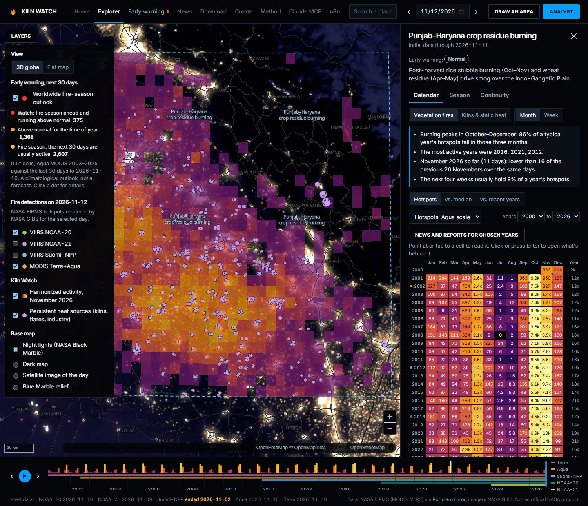
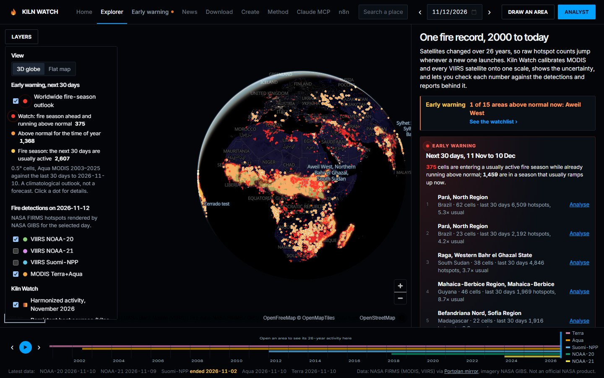
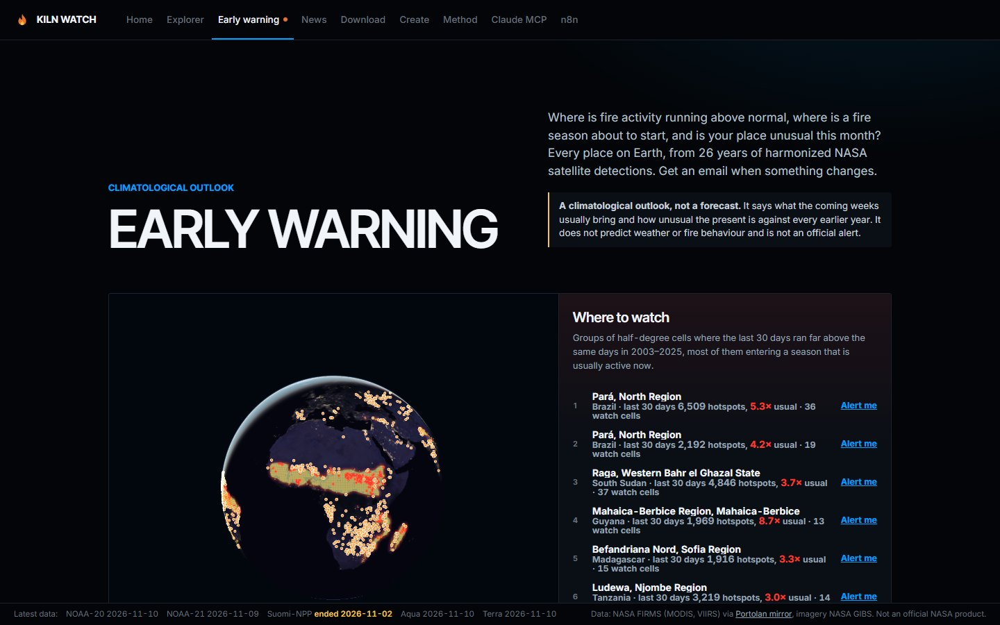
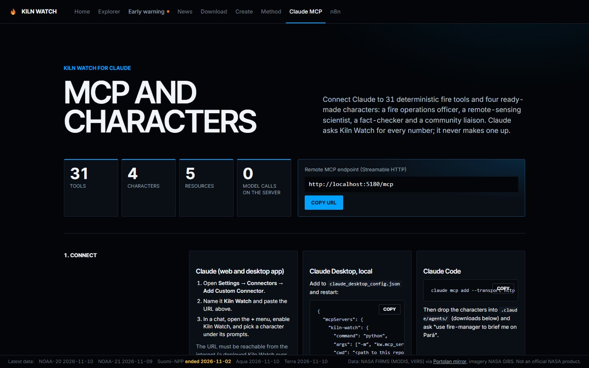
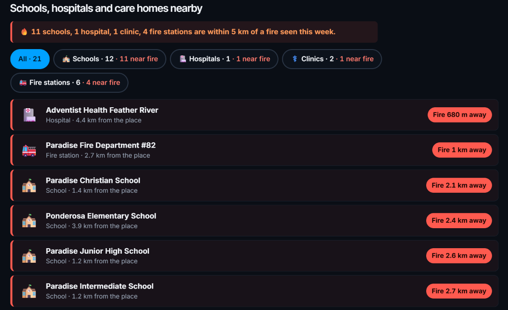
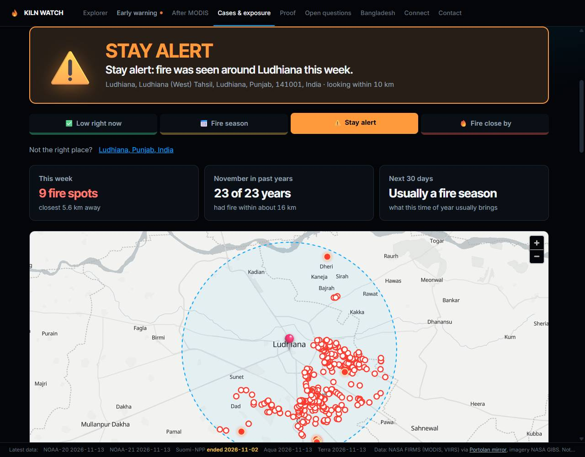
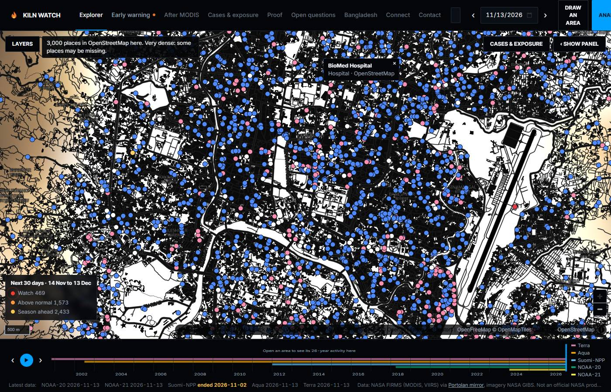
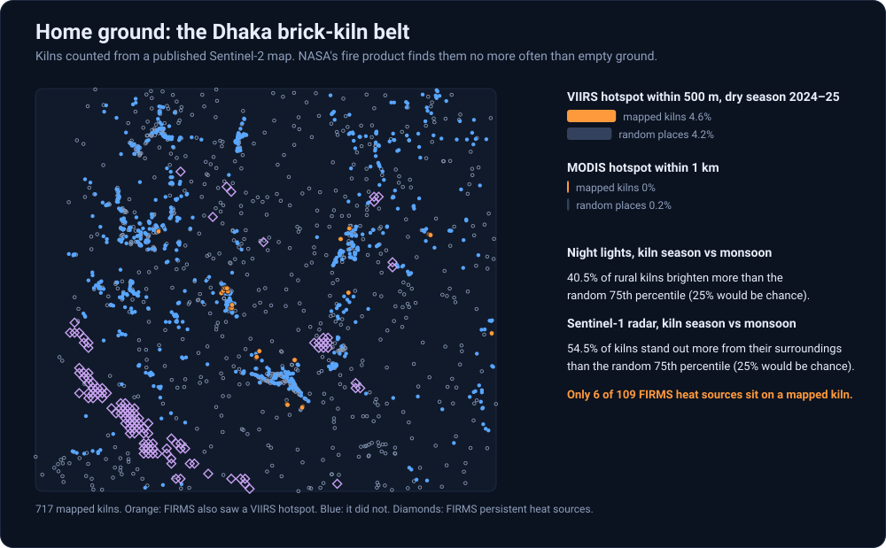
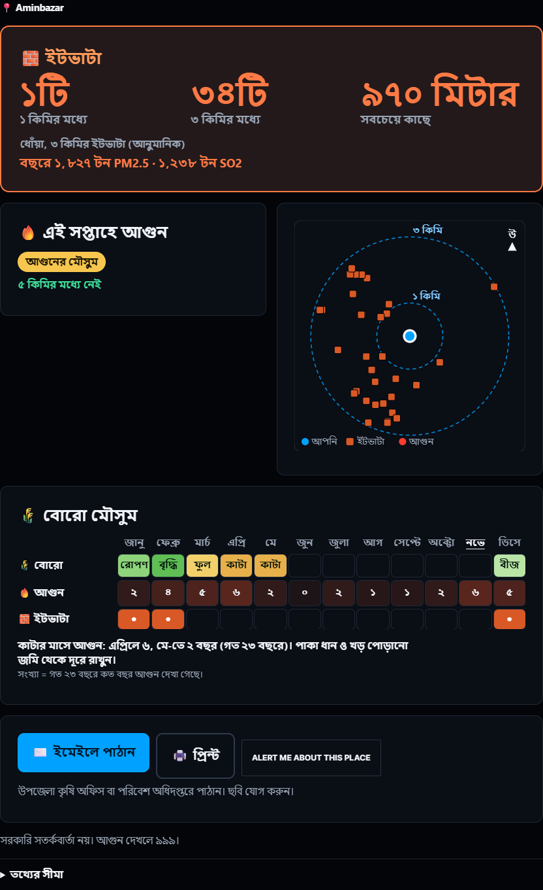
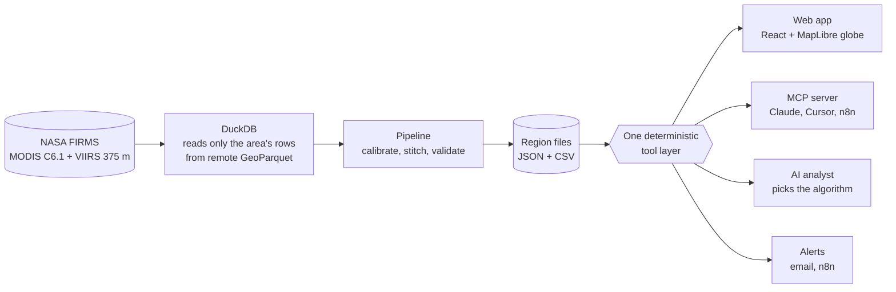

# Kiln Watch: the details

The [README](../README.md) is the short version. This page keeps the rest: the method's reasoning, every known shortfall, exposure, the place check, the Bangladesh measurements, NASA's open questions, how it is built and hosted, and the references.

## Method and results

### Why this method

- **Measured on what we publish.** The sensor gap is measured on monthly detection totals, the quantity in the record, so no
  model of fire physics has to be right first. VIIRS sees many small fires MODIS cannot ([Schroeder et al. 2014](https://doi.org/10.1016/j.rse.2013.12.008);
  [Giglio et al. 2016](https://doi.org/10.1016/j.rse.2016.02.054)), and the ratio absorbs that difference as it is.
- **A ratio of totals, not a regression.** Both sensors count with error, so regressing one on the other biases the slope
  toward zero ([regression dilution, Frost & Thompson 2000](https://doi.org/10.1111/1467-985X.00164)). For Poisson counts with
  a common rate ratio, the ratio of totals is its maximum-likelihood estimate.
- **Seasonal, not over-fitted.** One ratio per calendar month, shrunk toward the all-year ratio by empirical Bayes
  ([Efron & Morris 1975](https://doi.org/10.1080/01621459.1975.10479864)), with the between-month variance estimated by the
  method of moments ([DerSimonian & Laird 1986](https://doi.org/10.1016/0197-2456(86)90046-2)).
- **No near-simultaneous pairs needed.** Fire-by-fire or pixel matching needs the two satellites to look within minutes.
  Aqua's pass has drifted later since 2020, so such pairs become rare. Monthly totals only need both satellites in orbit that month.
- **Tested by taking satellites away**, with intervals widened by split conformal prediction
  ([Lei et al. 2018](https://doi.org/10.1080/01621459.2017.1307116)) and checked out of sample. Trends use
  [Sen's slope (1968)](https://doi.org/10.1080/01621459.1968.10480934).

Each part is a published, standard tool. The way they are combined for MODIS and VIIRS is ours, and the tests above are its proof.

**The main alternative was tried, and lost.** MODIS detects a fire only above a certain fire power, so the sensor ratio could
follow the fire mix. We added a term for the month's mean Suomi-NPP fire power per detection to the Suomi-NPP → Aqua ratio,
fitted on 2012–2016 and scored on 2017–2020 (`transfer_validation.fire_size_term` in each `meta.json`):

| | Ratio per calendar month (ours) | Plus a fire-size term |
|---|---|---|
| Mean absolute log error, 9 areas | **0.459** | 0.460 |
| Areas where it lowers the log error | – | 3 of 9 (Fort McMurray, Rondônia, south-east Australia) |
| Areas where it raises the error in detections | – | 6 of 9 |
| Bias, Northern California / Paraná Delta | +21.0% / +36.9% | +50.1% / +140.2% |

It helps in some large-fire areas, but its slope does not hold from the training years to the test years elsewhere, so it is
not used. An area-specific version is an open next step.

### Where it still falls short

We publish these, not hide them. Every alternative we tested and every check the record failed, with the numbers, is in
**[HARMONIZATION_TESTS.md](../HARMONIZATION_TESTS.md)**: a failed test is a finding too.

- **The ratio per calendar month is not yet better than one ratio per area on totals.** In the MODIS-denial test it
  lowers the monthly error in 5 of 9 areas (Punjab: mean absolute error 146 against 271 hotspots a month), but its
  bias on the 2017–2020 total is larger in 5 of 9 (La Rioja −9.7% against −1.8%, Dhaka +13.1% against +8.5%).
  `denial.modis_ends_2016` in each `meta.json` holds both. We tested three fixes on months they never saw (training
  cut-offs 2015, 2016 and 2017): choosing between the two per link from a split inside the training years, and
  weighting recent years more. Neither wins at all three cut-offs, so the method is unchanged
  (`data/validation/calibration_variants.json`, from `scripts/validation/calibration_variants.py`).
- **After MODIS, the chain does not fully close.** From 2023 the record runs NOAA-20 → Suomi-NPP → Aqua. The direct
  NOAA-20 → Aqua ratio and that chain disagree by +18% (day) and +28% (night) in Punjab, +48% at night in Northern
  California, +90% at night in south-east Australia and −34% / −63% in Dhaka (`closure` in `meta.json`). The mismatch is
  added to the interval, not removed. Held out on 2021–2022, when Aqua still flew its old orbit, NOAA-20 alone through
  the chain predicts Aqua with a mean monthly log error of 0.345, against 0.373 for the direct link and 0.373 for one
  ratio per area (mean total bias 9.3%, 9.4% and 13.0%), so the chain is kept (same file).
- **NOAA-21 steps are wider than Suomi-NPP's**: 0.63 (Rondônia) to 1.34 (La Rioja), against 0.93–1.18. NOAA-21 arrived in
  2024, when Aqua was already drifting, so its step mixes the new satellite with Aqua's change.
- Five of nine regions land inside their no-change range. Punjab clearly misses: it still under-corrects by about 6%.
- Paraná Delta is off by +27%. Its record 2020 fire year is unlike anything the calibration years saw.
- Northern California's out-of-sample interval coverage is 79%: its intervals are too narrow for years unlike 2017–2018.
- No cloud-cover correction yet. The early-warning rule is now backtested per area (Early warning page), but in sparse areas the
  scored months lean toward active ones, so its skill numbers there are not yet comparable across areas.
- **The early-warning backtest flattered itself, and we now say by how much.** On day 15 the rule's skill was scored
  against the whole month, which contains the 15 days it had already seen. Scored only on the 16th to the month's end,
  the skill falls (Punjab 0.77 → 0.38, Alberta 0.82 → 0.59, Niger Delta 0.54 → 0.06). Against a simple reference,
  "last month was in the top tenth", the rule wins in Alberta, Punjab and south-east Australia, ties in Northern
  California, and loses in the Paraná Delta, Rondônia and the Niger Delta. It is a climatological outlook, not a
  forecast (`warning_backtest.by_day` in `meta.json`: `elevated_rest_of_month`, `elevated_persistence`).
- The 30-day outlook now runs on NOAA-20 VIIRS put on the Aqua scale, so it does not stop with Aqua. Held out on 2022 the
  total is off by +0.9% and the cell ranking agrees at ρ = 0.84, but its "above normal" flag agrees with Aqua's own on only
  41% of cells (NOAA-20 finds 681 of Aqua's 1,325 and adds 318): the two satellites sample different small fires. A single
  dot is a hint; the named regions group neighbouring cells. Other shrinkage weights gave 38–42%, so this is not a tuning issue.
- The casebook's news witness is only as good as GDELT (2017 on) and Google News; GDACS wildfire events start in 2021. A witness
  that could not look is shown as "could not look" with its reason, never as "nothing found". MODIS burned area is guided by
  MODIS hotspots, so it is not fully independent of the record. Event points are matched to hotspots in their cell, the 8 around
  it and the next month: those windows are judgement calls.
- Kilns: the kiln map shows structures from the 2024-25 dry season, not kilns in operation, and is licensed non-commercial.
  Night lights and Sentinel-1 radar are consistent with kilns, not proof of them, and neither says whether a kiln is firing.

### Checked against other data

Two checks run outside the pipeline and publish their results, whether they pass or not.

| Check | What it asks | Result |
|---|---|---|
| NASA MCD64A1 burned area, seven areas, 261–263 months each, 2003–2024 | Does the record track physical burned area, and is the 2012 jump real? | The raw detection count jumps ×4.89 in 2012; the harmonized record moves ×1.03; burned area, built from MODIS alone, moves ×0.72. The jump was an instrument change. Monthly rank correlation with burned area: 0.49 harmonized, 0.37 raw. |
| APAD Bangladesh brick-kiln inventory, 4,760 operating kilns | Do the published persistent-heat cells correspond to mapped kilns? | No. At 1 km, 2 of 109 cells (1.8%) land on a kiln; randomly placed cells of the same number land on one 8.3% of the time. The layer is a persistent-heat proxy, not a kiln inventory. |

Both are re-runnable (`scripts/validation/`), fail closed, and publish their sources, hashes and limitations with the
numbers: `data/validation/burned_area.json`, `data/validation/kilns_dhaka-kilns.json`.


## The product

<table>
<tr>
<td width="50%" valign="top"><br><b>Burning calendar.</b> Month by year, number in every cell, colour-blind-safe, keyboard navigable. Click a cell for the detections behind it.</td>
<td width="50%" valign="top"><br><b>Globe and 30-day outlook.</b> Every half-degree cell on Earth: what the next 30 days usually bring, and how unusual the last 30 were.</td>
</tr>
<tr>
<td valign="top"><br><b>Early warning.</b> A plain rule printed on the page. It compares with earlier years; it never forecasts. Alerts by email or n8n.</td>
<td valign="top"><br><b>Ask it anything.</b> An in-app analyst and an MCP server (35 read-only tools online, 40 locally) for Claude, Cursor and n8n. The AI model only picks which algorithm answers the question; the algorithm writes the answer, so every number comes from the pipeline.</td>
</tr>
</table>

**Is fire near you?** The check for any place and the "Who is nearby" map layer: see [Is fire near you?](#is-fire-near-you).

**Nine study areas in depth.** Each fire case is heard by six witnesses (the satellite record, a MODIS-against-VIIRS check, NASA EONET, GDACS, MODIS burned area, the news) and gets a plain verdict. Each witness that could not look says why. Beside it: the people, schools, hospitals, roads and farmland in the cells where fire was seen ([Exposure](#exposure-who-is-near-the-fire)).

**Bangladesh.** The Dhaka kiln belt is counted from a published kiln map and night lights, with NASA's fire product measured against it, not used to find kilns.

Also in the box: draw-your-own area, weekly view, season start and peak, news and event reports beside the data, SVG charts, a printable brief.

**Download exactly what you need.** Any built area, including one you drew, exports as CSV, TSV or JSON. You choose the table
(the monthly or weekly calendar, or the individual detections for up to a year), the years or dates, and the column groups
(harmonized hotspots with intervals, history against other years, satellites and coverage, raw counts, quality flags). The same
choices are in the Explorer panel (Download), on the Download page, in the API and in MCP (`export_data`, which lists the column
groups and asks you which you want). Files start with `#` comment lines (unit, source, code version) unless you switch them off;
JSON carries the same provenance in a block. Raw per-satellite counts are optional and labelled: they rise whenever a satellite is added.

```bash
BASE=https://kiln-watch-jp.orangewave-2c5aad89.japaneast.azurecontainerapps.io
curl "$BASE/api/export/options"                      # formats, column groups, limits
curl -o punjab.csv "$BASE/api/regions/punjab/export?columns=hotspots,history&start=2015&end=2025"
curl -o hot.json  "$BASE/api/regions/punjab/export?kind=detections&format=json&columns=where,strength&start=2025-04-01&end=2025-04-30&used_only=true"
```


## Exposure: who is near the fire

A detection says where heat was seen. The next question is always who and what is there. Kiln Watch answers it at
two scales, and both say plainly when a source could not be reached.

**For a whole area, over 26 years.** Every 0.1° cell where the record shows fire since 2000 carries five layers:

| Layer | Source | In each fire cell |
|---|---|---|
| People | WorldPop 2020, 1 km | Modelled population |
| Schools and kindergartens | OpenStreetMap | Count, and the named ones listed |
| Hospitals and clinics | OpenStreetMap | Counted apart, named ones listed |
| Major roads | OpenStreetMap | Motorways, trunk and primary roads by name |
| Cropland | ESA WorldCover 10 m, 2021 | Square kilometres of farmland |

| Area | People in fire cells | Schools | Hospitals | Clinics | Major roads | Cropland, km² |
|---|---|---|---|---|---|---|
| Dhaka brick-kiln belt | 33,187,073 | 1,964 | 671 | 439 | 325 | 4,302 |
| Punjab–Haryana | 54,566,902 | could not look | 4,477* | 2,143 | 725 | 80,155 |
| Chilecito, La Rioja | 324,621 | 141 | 39 | 20 | 42 | 163 |
| Rondônia | 1,425,955 | could not look | 33 | 25 | 63 | 743 |
| Fort McMurray | 101,716 | 33 | 2 | 3 | 7 | 46 |
| South-east Australia | 2,972,434 | could not look | 135 | 495 | could not look | 22,601 |
| Northern California | 3,292,014 | 1,458 | 63 | 218 | 331 | 5,000 |
| Paraná Delta | 3,096,778 | 1,905 | 177 | 482 | could not look | 31,178 |
| Niger Delta | 36,622,013 | 582 | 124 | 84 | could not look | 710 |

<sub>Built by `scripts/build_exposure.py` into each area's `exposure.json`; this table is read from those files. "Could not look":
the OpenStreetMap server timed out, so the count is unknown, not zero. *Punjab's named hospital list stops at the 1,500 cap.</sub>

**For one place, this week.** "Is fire near you?" lists every school, hospital, clinic, care home and fire station within
25 km, each with its distance to the nearest fire seen in the last 7 days, red when it is within 5 km.

<p align="center"></p>

**What exposure is not.** It is context, never impact. FIRMS gives detections, not fire perimeters, and there is no smoke
or fire-spread model here. WorldPop is modelled, not a census, and not the population on the day of a fire.
OpenStreetMap is only as complete as its volunteers have made it.

---

## Is fire near you?

**For families, students, fire managers and safety officers, anywhere on Earth.** Type a town, village, school or
address, or press "Use my location". The answer comes in plain words and pictures, with large text and big buttons for
people who are not used to maps.

<p align="center"></p>

| You see | Where it comes from |
|---|---|
| A traffic-light level: **low right now · fire season · stay alert · fire close by** | The rule `science.place_level`, printed on the page |
| The fire spots satellites saw within 5, 10 or 25 km in the **last 7 days**, on a street map | NASA FIRMS, every satellite, read live from the public mirror |
| **How many of the last 23 years** had fire there this month, and which months usually burn | A worldwide table of fire months per 0.1° cell, MODIS 2003–2025 (`data/global/fire_season.parquet`, 10 MB) |
| What the **next 30 days** usually bring | The worldwide 30-day outlook |
| **Schools, hospitals, clinics, care homes and fire stations** nearby, each with its distance to the nearest fire this week, red when it is within 5 km | OpenStreetMap |
| A one-click alert for the place | Email or n8n |

**How long it takes, honestly.** The fire answer usually comes in 5 to 20 seconds (up to a minute when NASA's data server is
slow). The list of schools and hospitals comes from OpenStreetMap's free public servers: usually 20 to 45 seconds, and the
page says so and offers a retry if they do not answer within about a minute. Places already looked up are instant for a week.

**On the live map too.** In the Explorer, the layer **Who is nearby** puts the same schools, hospitals, clinics, care homes
and fire stations on the globe next to the fire layers. Click one for its name; switch it on and off in the Layers panel.
Zoom in to a town to load it. In the nine study areas a list appears at once while the full one loads; elsewhere a new
town takes up to a few minutes the first time, and the map stays usable meanwhile.

<p align="center"></p>

**For developers and AI assistants.** The same answer is a public API with no key, and an MCP tool for Claude:

```bash
curl "https://kiln-watch-jp.orangewave-2c5aad89.japaneast.azurecontainerapps.io/api/place-risk?q=Ludhiana,%20India&radius_km=10"
curl "https://kiln-watch-jp.orangewave-2c5aad89.japaneast.azurecontainerapps.io/api/facilities?west=85.25&south=27.65&east=85.5&north=27.75"
```

MCP: `check_place_fire_risk`. Every endpoint is listed at `/docs` on the API.

**What it is not.** A dot is heat seen from space a few hours ago, not a confirmed fire; factories, gas flares and kilns can
show as heat. History is not a forecast. This is not an official warning: in an emergency, call your local fire service.
A source that could not answer says so; it is never shown as "no fire" or "no buildings".


## Who it is for

| Anywhere on Earth | At home, in Bangladesh |
|---|---|
| **Families, schools and hospitals** check their own street in plain words: [Is fire near you?](#is-fire-near-you) | **Dhaka's brick-kiln belt** is our home test case and the place the project is named after. It is where raw counts mislead most: a 10.6× false jump. |
| **Fire managers** see whether this month is unusual against 26 comparable years, not 14. | **NASA's fire product cannot count kilns, so we do not ask it to.** We measured it (table below) and count kilns from a published kiln map instead. |
| **Scientists** get a record with intervals, provenance and the calibration table to download. | **Night lights and radar are the second and third witness.** NASA Black Marble and Sentinel-1 both change at mapped kilns between the monsoon and the kiln season. |
| **Everyone after MODIS.** Terra and Aqua are near the end of their lives. The denial test shows the record carries on without them, and the 30-day outlook is now counted by NOAA-20 VIIRS, so it does not stop with Aqua. | **We changed our own labels.** The map's "persistent heat sources" used to be called kilns. The data said otherwise, so the name went. |

**What we measured in the Dhaka kiln belt**

| Question | Answer | The numbers |
|---|---|---|
| Can NASA's fire product find kilns? | No | Of 717 kilns on a published Sentinel-2 kiln map, 4.6% had a VIIRS hotspot within 500 m in the 2024-25 dry season. Random places far from any kiln: 4.2%. MODIS: 0% against 0.2%. |
| Do NASA Black Marble night lights change in kiln season? | Consistent with kilns | 40.5% of rural kilns brighten more between the monsoon and the dry season than the random 75th percentile. Chance would be 25%. |
| Does Sentinel-1 radar change in kiln season? | Consistent with kilns | A mapped kiln's contrast with its surroundings rises a median 0.67 dB from the monsoon to the dry season (random places: 0.03 dB). 54.5% of kilns are above the random 75th percentile. |
| Are the FIRMS "persistent heat sources" kilns? | No | Only 6 of the 109 sit on a mapped kiln. |

<p align="center"></p>

<p align="center"><sub>The map shows kiln structures in the 2024-25 dry season, not kilns in operation; about 8 in 10 detections inside human-labelled footprints are kilns, about 2 in 10 outside. Licence CC BY-NC 4.0 (non-commercial). Night lights and radar are consistent with kilns, not proof: kilns sit on town edges that also brighten in winter, and radar also responds to buildings and moisture. A second, independently licensed inventory (APAD, CC BY 4.0) reaches the same conclusion about the persistent-heat cells: see <a href="#checked-against-other-data">Checked against other data</a>.</sub></p>

### For farmers: what is near your field?

Farmers near brick kilns report smoke damage to rice, mango and vegetables in the dry season, and kilns burn coal: smoke,
sulphur and CO2. When they complain, they are often asked to show that a kiln is there at all. The
[Bangladesh page](https://kiln-watch-seven.vercel.app/#pg=bangladesh) lets them: a dated record of the kilns around
their field, from a national inventory checked against satellite images, with the kilns' estimated smoke. In Bangla first:

1. Press **Use my location** in the field, or type the village or market.
2. Read the answer: kilns within 1 km and 3 km and the nearest one, their estimated smoke (tonnes of PM2.5, fine smoke particles, and SO2, sulphur gas, a
   year), fire seen within 5 km this week, and the **Boro
   season** on one 12-month strip: seedbed to harvest (BAMIS crop calendar), how many of the last 23 years had fire
   nearby in each month (NASA MODIS), and the kiln season (NASA Black Marble). It names the fire years in the April–May
   harvest months, so straw and threshed paddy can be kept away from burning fields.
3. **Email this report** (or **Send on WhatsApp**) opens the phone's own email app with everything written in, ready for the Upazila Agriculture
   Officer or the Department of Environment; **Print one page** gives a Bangla sheet for an office or a union notice board.
   An email alert can be set for fire near the field.

<p align="center"></p>

| Across Bangladesh | Number | Source |
|---|---|---|
| Kilns in the national inventory | 4,760 | APAD (CC BY 4.0) |
| Kilns with cropland on half or more of the land within 1 km | 2,802 (59%) | ESA WorldCover 10 m, measured around each kiln |
| Listed kilns within 300 m of a kiln seen in Sentinel-2 imagery (Dhaka area) | 84.5%, against 4.2% for random places | Cross-check with the Sentinel-2 kiln map |
| Sentinel-2 kilns that the inventory lists (Dhaka area) | 52% | Same cross-check: counts are a floor, not the full number |
| Estimated smoke from all listed kilns | 248,939 t PM2.5 and 168,633 t SO2 a year | APAD's modelled estimate per kiln (capacity × emission factor by kiln type), not measured |
| Example: Aminbazar, Savar | 34 kilns within 3 km, the nearest 970 m away; about 1,827 t PM2.5 a year | The check on the page |

Kiln positions come from the inventory, never from FIRMS. The inventory stops at about 90.9° E, so Chattogram, Sylhet and
the east of Dhaka division get "no kiln data here", never "0 kilns". It shows kiln structures, not whether one is firing.
It shows that kilns stand near a field; it does not prove that a kiln damaged a crop, and whether a kiln breaks the brick
kiln law is the Department of Environment's call. Built by
`uv run --with rasterio --with numpy python scripts/build_farm_kilns.py` into `data/global/kilns_bd.json`; served by
`GET /api/farm-check?lat=&lon=`.


## Open questions from NASA's discussions

We read every thread about this challenge on NASA's Space Apps GitHub (14 November 2026). For each question, the table gives our
answer. The full page, with tables built from the data, is
[Open questions](https://kiln-watch-seven.vercel.app/#pg=questions).

| Thread | Question | Our answer | Status |
|---|---|---|---|
| [#1879](https://github.com/nasa/spaceapps/discussions/1879) | MODIS- or VIIRS-equivalent? (reply: either, if justified) | Aqua MODIS scale. Converting VIIRS down is well-posed; going up would invent small fires. The VIIRS-scale view marks pre-2012 months *modelled* | Built in |
| [#1879](https://github.com/nasa/spaceapps/discussions/1879) | Standard FIRMS archive, or swath products? (reply: FIRMS) | FIRMS standard and near-real-time. NRT rows have no `type` flag, so cells are typed from their standard-processing history; NRT months are *provisional* | Built in |
| [#1879](https://github.com/nasa/spaceapps/discussions/1879) | Suomi-NPP stopped; continuity with NOAA-20/21? (reply: yes) | The question says 2 Nov 2022. The data says Suomi-NPP's last day is **2026-11-02**, detected rather than typed in. NASA's own pages disagree on the hour (FIRMS blog 13:00 UTC, FIRMS FAQ 15:40 UTC); we count days, so the record does not depend on it. The chain NOAA-21 → NOAA-20 → Suomi-NPP → Aqua carries the record on | Built in |
| [#1879](https://github.com/nasa/spaceapps/discussions/1879) | Users and time step? (reply: responders to scientists; monthly solid, weekly if readable) | Monthly calendar by default, a weekly grid one switch away, daily detections behind every cell | Built in |
| [#1879](https://github.com/nasa/spaceapps/discussions/1879) | Is Earth Engine acceptable? (reply: yes, prefer NASA resources) | The fire record uses FIRMS only. Earth Engine is used at build time for witnesses (MCD64A1, Black Marble, Sentinel-1) | Built in |
| [#1786](https://github.com/nasa/spaceapps/discussions/1786) | Off-nadir pixels grow to about 2 km. How to harmonize? | **Measured**, 2012–2020. Where fire is frequent, the share of Aqua detections in the outer half of the swath moves ±3–5 points a year, and Suomi-NPP ÷ Aqua is the same in the inner and outer halves (Punjab 5.8 and 5.8). So a ratio of monthly totals absorbs it. In event-driven seasons it does not: Fort McMurray ±17 points, outer ratio 16.5 against 9.3 inner | Measured; not yet stratified |
| [#1786](https://github.com/nasa/spaceapps/discussions/1786) | Some hotspots only VIIRS sees, some only MODIS | **Measured**: 40–91% of Aqua detections have a Suomi-NPP detection within about 1 km on the same day and pass; only 5–56% of Suomi-NPP detections have an Aqua one. The VIIRS-only ones are small fires (median FRP 1.9–4.9 MW against 5.4–12.8 MW matched). We calibrate totals, never pair points, so they are kept | Measured |
| [#1786](https://github.com/nasa/spaceapps/discussions/1786) | The global CSV is about 45 GB. Global, or one place? | DuckDB reads only an area's rows from remote GeoParquet. Nine areas are prebuilt; any box up to 16 square degrees can be built on demand | Built in |
| [#2016](https://github.com/nasa/spaceapps/discussions/2016), [#1959](https://github.com/nasa/spaceapps/discussions/1959) | One region? Own FIRMS downloads? (replies: yes; document them) | Nine areas plus draw-your-own. Every file records products, versions, period, box and code version | Built in |
| [#1879](https://github.com/nasa/spaceapps/discussions/1879) (reply) | Cloud: no detection may mean no clear view | **Not solved yet.** We divide by the days each satellite observed, not by cloud-free views. Next step: use the cloud class of the MYD14A1 fire mask as a clear-sky denominator | Open |

**Raised elsewhere, in NASA pages and papers:**

| Source | Problem | Our answer | Status |
|---|---|---|---|
| [Earthdata alert](https://www.earthdata.nasa.gov/data/alerts-outages/transition-from-modis-viirs), [CAMS](https://atmosphere.copernicus.eu/drifting-away-modis-cams-global-fire-assimilation-system) | Terra and Aqua are drifting and will stop (CAMS: Terra January 2027, Aqua around September 2027) | Aqua's drift onset is measured from FIRMS timestamps; from it the record runs on VIIRS on the Aqua scale. Tested by switching MODIS off | Built in |
| [FIRMS blog](https://www.earthdata.nasa.gov/news/blog/transitioning-from-suomi-npp-viirs-omps-what-firms-users-need-know) | Terra is the only morning overpass; NASA is "investigating alternatives" | The record is defined on Aqua's afternoon and post-midnight passes, which NOAA-20/21 continue, so it stays consistent. But it never measured morning burning, and nothing here replaces Terra | Open |
| [FIRMS FAQ](https://www.earthdata.nasa.gov/data/tools/firms/faq) | NRT differs from standard data: geolocation, no type, day/night by orbit direction instead of solar zenith | NRT months are *provisional* and typed from cell history. The day/night rule is not reconciled, so at high latitudes a provisional month can put detections in the other half | Partly |
| [Li et al. 2018](https://agupubs.onlinelibrary.wiley.com/doi/full/10.1029/2017jd027823) | VIIRS FRP about 47% lower than MODIS for large boreal fires | We harmonize counts, not FRP. FRP totals must not be compared across the 2012 switch | Open |
| [arXiv 2510.26816](https://arxiv.org/pdf/2510.26816) | Low-confidence VIIRS detections systematically absent at night | VIIRS low confidence is dropped day and night alike; day and night are calibrated apart | Built in |
| [GMD 2026](https://gmd.copernicus.org/articles/19/10123/2026/) | Detection probability varies by region (under 30% for MODIS in some equatorial areas) | Each area has its own calibration. Where both sensors miss (cloud, short fires) the record stays low in every year: the cloud item above | Partly |

Every other limitation is listed on the [Proof page](https://kiln-watch-seven.vercel.app/#pg=method) and under "Where it still
falls short" above. A question we have not answered? Use the
[contact form](https://kiln-watch-seven.vercel.app/#pg=contact) or [open an issue](https://github.com/Aalvee-Aarham/nasaspaceappschallenge-2026-team-off-the-binary/issues/new).

`nasa/MODIS-VIIRS-Data-Resources` holds access tutorials. Its five issues are closed documentation pull requests, none about
harmonization. Re-run the checks with `python scripts/discussion_checks.py` (writes `data/regions/discussion_checks.json`).


## How it is built



- **The 45 GB archive is never downloaded.** DuckDB reads only the chosen area's rows from remote GeoParquet, so a new
  area anywhere on Earth can be built on demand.
- **One tool layer, four front ends.** The website, the analyst, the MCP server and the alerts all call the same
  deterministic functions, so the same question gets the same number everywhere.
- **Every number can be traced.** Each file records its products, versions, period, box and code version, and all of
  it can be downloaded.
- **No key, no paid service.** Earth Engine is used at build time only (burned area, Black Marble, Sentinel-1), so the
  live site needs none.

<details>
<summary><b>Run it</b> (Python 3.11+, Node 20+)</summary>

```bash
cd server && pip install -r requirements.txt
uvicorn kw.api:app --port 8000        # built regions are committed: calendars work at once

cd web && npm install && npm run dev  # http://localhost:5173
```

Rebuild from NASA data: `python -m kw.firms && python -m kw.build`. The first build of a drawn area takes 5 to 10 minutes (much less on a machine that has run the one-off `python -m kw.globe`, 1.8 GB): it reads 26 yearly files, 4 at a time (`KW_FETCH_WORKERS`; 8 measured slower). The time depends on the years, not the box size.
Casebook witnesses (build time only; needs `pip install earthengine-api`, `earthengine authenticate` and `EE_PROJECT` in a git-ignored `.env`):
`python scripts/build_burned.py && python -m kw.cases` (burned area), `python scripts/build_kilns.py` (Dhaka kiln evidence, needs `python -m kw.firms` first).
The outlook (`python -m kw.outlook`) needs the global aggregate from `python -m kw.globe`.
The worldwide fire months behind "Is fire near you?" (`data/global/fire_season.parquet`, committed): `python -m kw.globe season`.
Tests: `python server/tests/test_science.py` (also `test_cases.py`, `test_api.py`). Figures on this page: `node scripts/readme_figures.mjs`.
Record-level independent checks: `python scripts/validation/kilns.py` and `uv run --with rasterio --with numpy --with planetary-computer python scripts/validation/burned_area.py` (results committed in `data/validation/`).
Analyst keys: set `GROQ_API_KEY` (primary), plus `GEMINI_API_KEY` and optional fallbacks `GEMINI_API_KEYS=key2,key3,...` in a git-ignored `.env` (and as
secrets on Azure and Vercel). The analyst moves to the next key when one hits its free-tier quota, is overloaded or is
refused, and uses the `gemini-flash-latest` alias so a retired model version does not break it. Never commit keys.
MCP setup, email alerts and deployment: the [Connect page](https://kiln-watch-seven.vercel.app/#pg=mcp) and [CLAUDE.md](../CLAUDE.md).
Contact form: messages go to `POST /api/feedback` and are appended to `data/feedback.jsonl` (git-ignored). With the SMTP
settings and `CONTACT_EMAILS` (comma-separated) set, each one is also mailed. The read-only Vercel copy refuses it, and on
Azure the file lasts only as long as the replica, so set the emails before relying on it.

**Two hosts, one site.** Vercel serves the site and a read-only API (its functions stop after a minute, too short for a
build). The full app (`Dockerfile`, site + API on port 7860, live builds on) runs on Azure Container Apps:
<https://kiln-watch-jp.orangewave-2c5aad89.japaneast.azurecontainerapps.io>. The Vercel project sets
`VITE_API_BASE` to that address, so the site sends every request to Azure and falls back to Vercel's own read-only API
when Azure does not answer `/api/health` within 15 s.

The Azure app is free-tier and **sleeps when nobody is using it**: the first request after a quiet spell takes a few extra
seconds, and its disk is wiped while it sleeps. So the alert list is kept in one Azure Blob (`KW_STATE_URL`), and a free
GitHub job (`.github/workflows/wake.yml`) wakes the server every 3 hours so it checks every alert and sends the emails.
An alert email can therefore come a few hours after the satellites see fire; every email says so.

**Signing up for an alert with an email** starts it at once (no confirmation step: the audience is small and known).
Two emails follow on their own: the fire picture around the place (fire this week and how far, the usual fire months,
the 30-day outlook, the early-warning level, and the people, schools and hospitals near fire), usually within about a
minute; then fire across the whole country this week, read live from NASA FIRMS (detections per satellite, the busiest
places, the cells on fire-season watch, open NASA EONET wildfires), within a few minutes. A source that cannot be read
is named in the email ("Could not look: …"), never shown as zero. Every push runs the six
test suites and the type check (`.github/workflows/tests.yml`).

| Piece | Where | Notes |
|---|---|---|
| Container App `kiln-watch-jp` | environment `kiln-watch-env-jp`, Japan East (Azure for Students allows only five Asian/UAE regions; the AI analyst's providers refuse East Asia) | scales to zero when idle, never more than one copy (builds live on its disk) |
| Registry `kilnwatch1114.azurecr.io` | same group, Basic tier | about US$5/month from student credits; the app itself stays inside the Container Apps free monthly grant for a demo |
| Image build | GitHub Actions, `.github/workflows/azure-image.yml` | Azure for Students blocks ACR Tasks, so GitHub builds the image on every push to `main` that touches the app (secrets `ACR_USERNAME`, `ACR_PASSWORD`) |
| State | Azure Blob `kilnwatchstate`, Japan East | the alert list survives the server sleeping (`KW_STATE_URL`) |

Checked after deploy: health answers with `serverless: false`, the Vercel origin gets CORS, and a live 1°×1° build
(northern Thailand) finished in about 5 minutes with the same Aqua drift onset (2023-01) as the prebuilt areas.
That build read the 26 yearly files one at a time. They are now read four at a time (`KW_FETCH_WORKERS`; eight was slower on a
local test), which took a full 27-year fetch on a development machine from an estimated 3.5 minutes (27 years at about 8 s) to 90 s, with identical rows. The Azure timing after this change has
not been measured yet, so the site promises 5 to 10 minutes.

Limits: the first request after idle waits a few seconds while a replica starts; an area built live lasts until the
replica stops (the nine prebuilt areas are in the image). The workflow pushes images but does not roll them out; after
it finishes run
`az containerapp update -n kiln-watch-jp -g kiln-watch-rg --image kilnwatch1114.azurecr.io/kiln-watch:<commit sha>`.
Hugging Face Spaces would also run this `Dockerfile`, but Docker Spaces now need a PRO account.

</details>

## References

<details>
<summary><b>Papers, NASA documentation and challenge sources</b></summary>

<br>

**Challenge**
- [Harmonization of MODIS and VIIRS Hot Spots, challenge page](https://www.spaceappschallenge.org/2026/challenges/modis-and-viirs-hot-spots/?tab=details)

**Sensor status**
- [Transitioning from Suomi NPP VIIRS & OMPS: What FIRMS Users Need to Know](https://www.earthdata.nasa.gov/news/blog/transitioning-from-suomi-npp-viirs-omps-what-firms-users-need-know) (NASA Earthdata)
- [MODIS to VIIRS Transition](https://ladsweb.modaps.eosdis.nasa.gov/learn/modis-to-viirs-transition) (LAADS DAAC)
- [Aqua MODIS Acquisition Plan Through August 2026](https://lpdaac.usgs.gov/news/aqua-modis-acquisition-plan-through-august-2026/) (LP DAAC)
- [Terra orbital drift](https://modis-land.gsfc.nasa.gov/news.html) (MODIS Land)
- [VIIRS Instruments Become More Essential As Terra and Aqua Drift](https://www.earthdata.nasa.gov/news/feature-articles/viirs-instruments-become-more-essential-terra-aqua-drift-traditional-orbits) (NASA Earthdata)
- [NASA continuity workshop slides](https://www.earthdata.nasa.gov/s3fs-public/2023-03/RFI_TAA_continuity_workshop.pdf)
- [Drifting away from MODIS in the CAMS Global Fire Assimilation System](https://atmosphere.copernicus.eu/drifting-away-modis-cams-global-fire-assimilation-system)
- [NOAA-21 Active Fires provisional readme](https://www.star.nesdis.noaa.gov/JPSS/documents/AMM/N21/NOAA-21_Active_Fires_Provisional_Readme.pdf) · [NOAA-20 Active Fire maturity review](https://www.star.nesdis.noaa.gov/JPSS/documents/AMM/N20/Land_ActiveFires_Iband_Beta_Provisional.pdf)

**FIRMS data**
- [Active Fire Data Attributes for MODIS and VIIRS](https://www.earthdata.nasa.gov/data/tools/firms/active-fire-data-attributes-modis-viirs) · [FIRMS FAQ](https://www.earthdata.nasa.gov/data/tools/firms/faq)
- [VIIRS Collection 2 375 m Active Fire User Guide](https://ladsweb.modaps.eosdis.nasa.gov/archive/Document%20Archive/Science%20Data%20Product%20Documentation/VIIRS_C2_AF-375m_User_Guide_1.0.pdf)
- [MODIS Fire User Guide, Collection 6.1](https://lpdaac.usgs.gov/documents/1005/MOD14_User_Guide_V61.pdf)
- [Systematic Absence of Low-Confidence Nighttime Fire Detections in VIIRS (preprint)](https://arxiv.org/pdf/2510.26816)

**Harmonization science**
- [Observation operator and detection limits for MODIS and VIIRS FRP products (GMD, 2026)](https://gmd.copernicus.org/articles/19/10123/2026/)
- [Li et al. 2018, Comparison of FRP estimates from VIIRS and MODIS](https://agupubs.onlinelibrary.wiley.com/doi/full/10.1029/2017jd027823)
- [FRP correction and spatiotemporal fusion of MYD14 and VNP14IMG (Remote Sensing, 2026)](https://doi.org/10.3390/rs18101650)
- [MODIS versus VIIRS in Northeast Asia](https://doi.org/10.3390/rs12182870) · [FRP missed by MODIS in Africa](https://www.mdpi.com/2072-4292/12/10/1561) · [MODIS Aqua versus VIIRS in Punjab](https://pmc.ncbi.nlm.nih.gov/articles/PMC6108185/)
- [VFEIv0 VIIRS-based emission inventory](https://gmd.copernicus.org/articles/15/8085/2022/gmd-15-8085-2022.html) · [GFED5NRT (ESSD, 2026)](https://essd.copernicus.org/articles/18/7535/2026/)
- [Prior-based mask for persistent heat sources (Remote Sensing, 2026)](https://www.mdpi.com/2072-4292/18/6/904) · [GOFC-GWIS global static thermal anomalies](https://gofcgold.umd.edu/sites/default/files/2024-11/GOFC_GWIS_2024_Roberts_short.pdf)
- [ESA CCI Soil Moisture ATBD (CDF matching, triple collocation)](https://admin.climate.esa.int/media/documents/ESA_CCI_SM_RD_D2.1_v2_ATBD_v06.1_issue_1.1.pdf) · [Harmonized DMSP–VIIRS night lights](https://www.nature.com/articles/s41597-020-0510-y)

**Fire products and statistical methods behind the calibration**
- [Schroeder et al. 2014, The New VIIRS 375 m active fire detection data product (RSE 143)](https://doi.org/10.1016/j.rse.2013.12.008) · [Giglio et al. 2016, The collection 6 MODIS active fire detection algorithm (RSE 178)](https://doi.org/10.1016/j.rse.2016.02.054)
- [Frost & Thompson 2000, Correcting for regression dilution bias (JRSS A)](https://doi.org/10.1111/1467-985X.00164) · [Efron & Morris 1975, Stein's estimator and its generalizations (JASA)](https://doi.org/10.1080/01621459.1975.10479864) · [DerSimonian & Laird 1986, Meta-analysis in clinical trials](https://doi.org/10.1016/0197-2456(86)90046-2)
- [Lei et al. 2018, Distribution-free predictive inference for regression (JASA)](https://doi.org/10.1080/01621459.2017.1307116) · [Sen 1968, Regression coefficient based on Kendall's tau (JASA)](https://doi.org/10.1080/01621459.1968.10480934)

**Related tools**
- [NASA FEDS / fireatlas](https://earth-information-system.github.io/fireatlas/docs) · [Global Forest Watch fire data](https://blog.globalforestwatch.org/fires/wildfire-trends-gfw-fire-data/) · [Our World in Data, GWIS record](https://ourworldindata.org/grapher/annual-number-of-fires)

</details>
